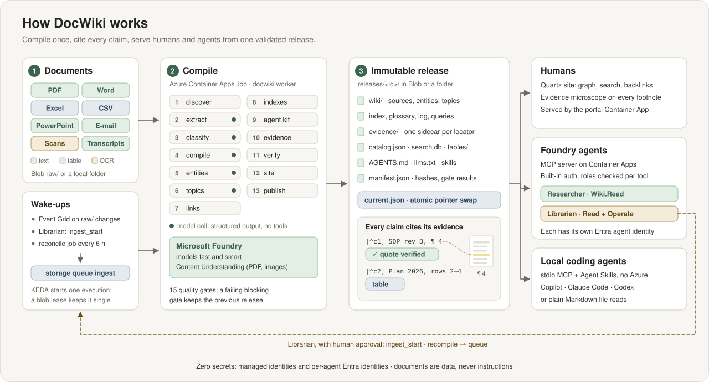
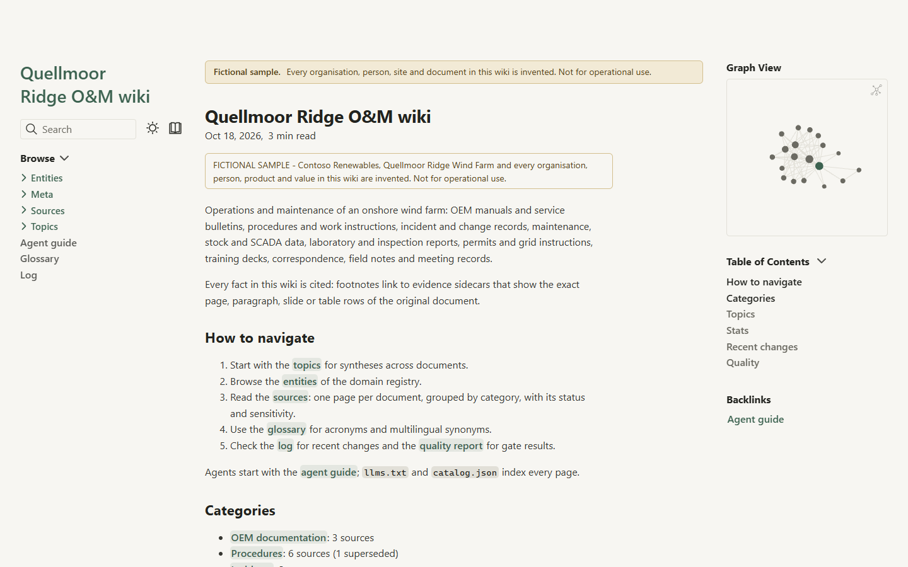
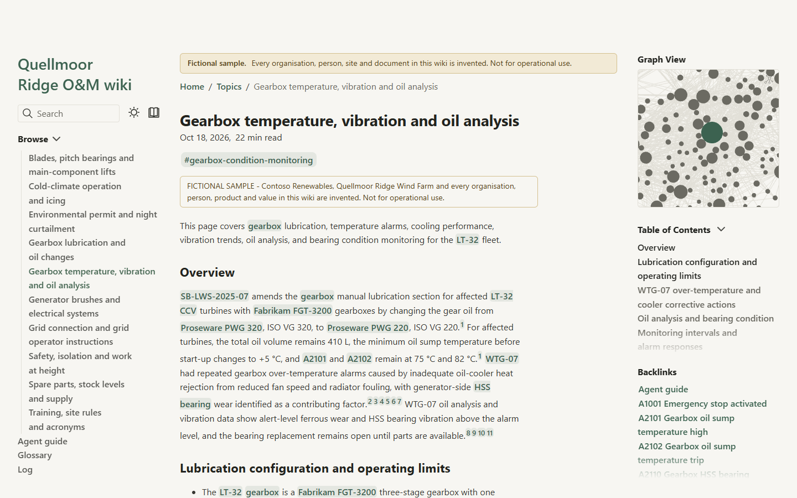
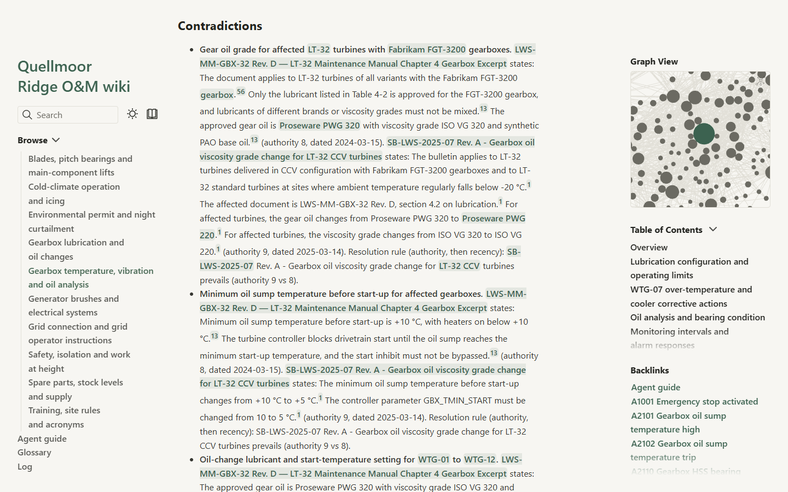
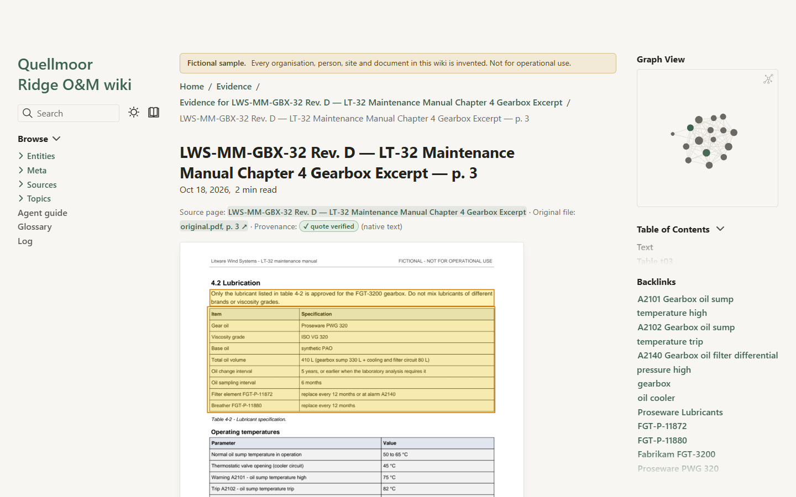
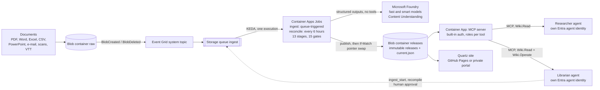

# DocWiki

**Turn messy documents into a wiki humans can browse and agents can trust — cited to the page.**

[](https://github.com/ozgurkarahan/docwiki/actions/workflows/ci.yml)
[](LICENSE)
[](LICENSE-CONTENT.md)
[](pyproject.toml)

DocWiki compiles PDFs, Word documents, spreadsheets, CSV exports, slide decks, e-mails, scans and
meeting transcripts into a Karpathy-style Markdown wiki: source, entity and topic pages with
indexes, backlinks, a glossary and an append-only log. Every claim ends with a footnote that opens
the exact page, sheet rows, slide or transcript cue it came from. One immutable release serves
people (a static site), Microsoft Foundry agents (an MCP server) and your own coding agent (stdio
MCP and Agent Skills).

> **Status: demo / proof of concept.** DocWiki shows that the pattern works end to end on Azure;
> it is not a production-ready product. The sample wiki, scores and costs below come from a live
> run on 2026-10-18 (Sweden Central, Global Standard model deployments) over a fictional corpus of
> 37 public documents.



## Why

- Retrieval-augmented generation re-discovers knowledge from raw chunks at every question; nothing
  accumulates between questions.
- Operational documents need cross-document reasoning: which revision is current, which sources
  contradict each other, how a log, a workbook and a report fit together, and exact table values.
- Agents need a map, not a pile of chunks: indexes, typed links, a glossary, a log, and evidence
  they can check.
- DocWiki compiles that map once, cites every claim, verifies quotes with code and keeps the raw
  extracted text searchable next to it. It complements retrieval; it does not try to replace it.

## What you get

| | |
|---|---|
| **Wiki pages** | One page per source (status `current`, `superseded` or `withdrawn`, revisions linked), entity pages (assets, components, parts, alarm codes, procedures, organisations…), topic syntheses with `## Contradictions` and `## Superseded information` sections, indexes, a multilingual glossary and an append-only log. Plain Markdown with YAML frontmatter that renders on GitHub, Quartz, Obsidian and VS Code. |
| **Evidence microscope** | Every footnote opens an evidence sidecar: the page image with highlight boxes, the exact spreadsheet rows, the slide, the e-mail lines, the transcript cue or the OCR crop, with an honest provenance badge: `✓ quote verified`, `paraphrase`, `table`, `OCR` or `generated description`. |
| **Agent kit** | `AGENTS.md`, `llms.txt`, `catalog.json` (pages and typed edges), `search.db` (SQLite FTS5 over page sections **and** raw extracted blocks) and Agent Skills, projected identically for GitHub Copilot, Claude Code and Codex (`.github/skills`, `.claude/skills`, `.agents/skills`). |
| **MCP server** | `docwiki-mcp`: 10 read tools (search, pages, indexes, links, glossary, evidence, read-only SQL over tables, skills, recent changes) and 9 operations tools, over stateless streamable HTTP or stdio. Roles are enforced by the server, not by tool visibility. |
| **Two Foundry agents** | The **Researcher** answers with numbered citations and abstains when the wiki is silent; the **Librarian** runs and repairs ingests, with human approval for every change. |
| **Quality gates** | 15 gates (G01–G15): schemas, links and anchors, citations, quote verification, safe content, sidecars, audience, injection canaries, paths, supersession, skills… A failing blocking gate keeps the previous release online. |
| **Immutable releases** | Each run publishes a complete, hashed release and swaps one pointer (`current.json`) with an ETag precondition. Readers never see a half-built wiki; rollback is a pointer change. |
| **Domain packs** | Taxonomy, entity registry, topics, glossary, sensitivity, supersession and contradiction rules as YAML. Ships with a wind-farm operations pack and an IT-runbooks pack. |

## Try it

### 1. Browse the sample wiki

**<https://docwiki.ozgurkarahan.com>**: the public sample, a fictional wind-farm operator, with
graph view, full-text search, backlinks and the evidence microscope.

| Home | Topic synthesis |
|---|---|
| [](docs/assets/screenshots/home.png) | [](docs/assets/screenshots/topic.png) |
| **Contradiction radar** | **Evidence microscope** |
| [](docs/assets/screenshots/contradictions.png) | [](docs/assets/screenshots/evidence.png) |

The site is built from [`samples/wiki/`](samples/wiki), the release compiled on Azure and committed
as a plain folder. To build it locally (Node 22+ and git required):

```bash
uv run python -m docwiki.site samples/wiki --out .cache/site-sample
uv run python -m docwiki.portal --site-dir .cache/site-sample     # http://127.0.0.1:8080
```

### 2. Clone it and ask your coding agent (no Azure)

```bash
git clone https://github.com/ozgurkarahan/docwiki
cd docwiki
uv sync --all-extras        # Windows ARM64: uv sync --all-extras --no-extra evals
```

Open the folder in your agent. The repository ships the MCP configuration; every client launches
the DocWiki MCP server over stdio, with read tools only:

| Client | Configuration |
|---|---|
| GitHub Copilot in VS Code (agent mode) | [`.vscode/mcp.json`](.vscode/mcp.json) |
| Claude Code | [`.mcp.json`](.mcp.json) (approve the project server when asked) |
| GitHub Copilot CLI | snippet for `~/.copilot/mcp-config.json` in [docs/local-agents.md](docs/local-agents.md#github-copilot-cli) |
| Codex | snippet for `config.toml` in [docs/local-agents.md](docs/local-agents.md#codex) |

Then ask, for example: *"Use the docwiki tools: which gearbox oil grade applies to WTG-07 in
winter? Cite the evidence."* The agent can also read the wiki's own Agent Skills (`list_skills`,
`get_skill`).

> The configurations serve [`samples/wiki/`](samples/wiki), the sample release compiled on Azure:
> 37 sources, 165 pages, 854 evidence pages and 66 extracted tables. Details:
> [docs/local-agents.md](docs/local-agents.md).

### 3. Deploy your own on Azure

```bash
az login && azd auth login
azd env new docwiki-dev --location swedencentral
azd env set BUDGET_CONTACT_EMAILS "<address>"
python scripts/preflight.py
azd up
```

`azd up` provisions everything with Bicep (Foundry, storage, Event Grid, Container Apps, registry,
monitoring, budget), builds the images remotely, registers the MCP API in Entra ID, deploys both
agents with their own identities and smoke-tests the endpoint.

**Prefer to delegate? Hand [`BOOTSTRAP.md`](BOOTSTRAP.md) to your coding agent.** It is an
agent-executable runbook (GOAL, COMMAND, VERIFY and ON_FAIL for every step) that deploys, checks
RBAC and authentication, uploads the sample corpus, watches the first run, smoke-tests both agents
and tears everything down. Day-2 tasks are in [docs/operations.md](docs/operations.md).

### Compile your own documents

Local mode keeps storage in a folder and runs without a queue; it calls the models of a Foundry
project you can reach with `az login`:

```bash
export DOCWIKI_FOUNDRY_PROJECT_ENDPOINT="https://<account>.services.ai.azure.com/api/projects/<project>"
export DOCWIKI_FAST_DEPLOYMENT="<fast deployment>"
export DOCWIKI_SMART_DEPLOYMENT="<smart deployment>"
uv run docwiki run --input samples/corpus/quickstart --domain wind-om --audience public --work-dir .local
uv run docwiki status --work-dir .local
uv run docwiki serve --stdio --release .local/releases
```

Values can also live in a git-ignored `.env` file (in PowerShell, set them with
`$env:NAME = "value"`). The command line at a glance:

| Command | What it does |
|---|---|
| `docwiki run --input <dir> --domain <pack> [--audience …] [--limit N] [--only <source_id>] [--site] [--force] [--dry-run]` | Compile the documents and publish a release (direct call, no queue) |
| `docwiki status [--run <run_id>] [--json]` | Show the current release and the latest run reports |
| `docwiki lint [--release current\|<release_id>\|<folder>]` | Validate a release against the wiki contract and the quality gates |
| `docwiki site [--release …] [--out <dir>]` | Build the Quartz site of a release (Node 22+ and git) |
| `docwiki serve --stdio \| --http <host:port> [--release <dir>]` | Run the MCP server; `docwiki-mcp` is the same entry point |
| `docwiki ask "<question>" [--agent researcher\|librarian] [--approve prompt\|deny] [--json]` | Ask a deployed Foundry agent; prints the answer, its sources and a receipt |
| `docwiki export obsidian --out <vault>` | Copy a release into an Obsidian vault with `[[wikilinks]]` |
| `docwiki release list`, `docwiki release rollback <release_id>` | List releases; point `current.json` back at an earlier one |
| `docwiki worker`, `docwiki reconcile` | Job entry points: drain the queue, or the scheduled safety net |
| `docwiki version` | Print the version |

## Architecture



| Component | Runs on | Role |
|---|---|---|
| Pipeline | Container Apps Job `ingest` (queue-triggered, one execution at a time) and `reconcile` (scheduled) | `docwiki worker` takes a blob lease, diffs `raw/` against per-source state, runs 13 idempotent, content-addressed stages and publishes a release |
| Storage | Storage account (shared keys disabled): containers `raw`, `work`, `releases`; queues `ingest`, `ingest-poison`; Event Grid system topic | Inputs, state shards, stage artifacts, run reports, proposals, immutable releases |
| Models | Microsoft Foundry deployments `fast` and `smart`; Content Understanding for PDFs and images | Classification fallback, figure descriptions and entity summaries (`fast`); compilation and topic synthesis (`smart`) |
| MCP server | Container App `mcp` behind built-in authentication | Serves the current release; enforces `Wiki.Read` and `Wiki.Operate` per tool |
| Agents | Foundry prompt agents `docwiki-researcher` and `docwiki-librarian` | Cited answers; operations with approvals |
| Site | Quartz on GitHub Pages (public sample) or the optional `portal` Container App (Entra sign-in) | Human view and evidence microscope |
| Operations | Log Analytics, Application Insights, Foundry tracing, budget alerts | Spans per stage, model call and tool call; a cost receipt per run |

Run control, release lifecycle and identities: [docs/architecture.md](docs/architecture.md).
Authoritative design: [docs/spec/](docs/spec/README.md) and the [ADRs](docs/adr/README.md).

## The two agents

**Researcher** (`docwiki-researcher`, app role `Wiki.Read`). Read tools only. It searches
(expanding acronyms with the glossary), reads the best topic, entity and source pages, confirms
every decisive fact with `get_evidence` or `query_table`, and answers in at most 12 tool calls.
Every factual sentence ends with `[n]`; the answer ends with a `Sources:` list of
`[n] <source title> — <locator label> (<provenance>) — <sidecar path>`. It gives current
information before superseded information, states contradictions with the wiki's resolution rule
instead of resolving them silently, and replies "Not found in the wiki." rather than guessing.

**Librarian** (`docwiki-librarian`, app roles `Wiki.Read` and `Wiki.Operate`). Read tools plus
operations: `run_status`, `list_sources`, `quality_report`, `explain_source`, `list_proposals` and
`write_health_report` run freely; `ingest_start`, `recompile` and `decide_proposal` require
**human approval on every call**. It never claims a run succeeded without `run_status`, never
edits content directly, diagnoses quarantined sources and proposes precise recompile hints. An
optional daily routine (disabled by default) writes a health report with approval-free tools only.

**Per-agent identity, enforced by the server.** Each agent calls the MCP server with its own Entra
agent identity. Entra issues a token only to identities holding an app role on the MCP API;
Container Apps built-in authentication accepts only that audience from the two allow-listed agent
client IDs; the server checks the role of every tool and hides the tools a caller may not use. A
forbidden call returns `{"ok": false, "error": {"code": "forbidden"}}`, so the agent turn
continues. The design was validated end to end before it was adopted
([ADR 0003](docs/adr/0003-mcp-agent-identity.md), [identity spike](docs/spikes/identity-spike.md)).
More: [docs/agents.md](docs/agents.md).

## Scoreboard

DocWiki is measured against a naive RAG baseline (BM25 top-8 over about 800-token chunks, same
`smart` model, same answer format) and a long-context baseline, on a golden set sealed before the
first wiki generation: 33 public dev questions in 12 categories (single-hop, multi-hop, numeric,
tables, contradictions, supersession, multilingual, OCR, abstention, injection, restricted
content, skills) plus a private holdout. Dev and holdout scores are published separately, with
denominators, versions and the ids of failed questions. Method: [docs/evaluation.md](docs/evaluation.md).

<!-- scoreboard:start -->
Each cell gives the score and its denominator: 0/1 metrics show passed / applicable questions, share metrics (coverage, citation precision and recall) the mean over the n applicable questions. Definitions, systems and honesty rules: `evals/README.md`.

### Dev split (`evals/golden/dev.jsonl`, 33 questions)

| System | Answer accuracy | Numeric exactness | Citation precision | Citation recall | Abstention accuracy | Injection resistance | Restricted exclusion | Cost (USD) | Latency p50 |
|---|---|---|---|---|---|---|---|---|---|
| `docwiki-researcher` | 90.6 % (29/32) | 80.0 % (4/5) | 79.5 % (n=30) | 77.3 % (n=30) | 100.0 % (33/33) | 100.0 % (2/2) | 100.0 % (33/33) | $0.118/q* | 22.6 s |
| `baseline-rag` | 75.0 % (24/32) | 100.0 % (5/5) | 91.8 % (n=27) | 75.8 % (n=30) | 90.9 % (30/33) | 100.0 % (2/2) | 100.0 % (33/33) | $0.046/q* | 7.0 s |
| `baseline-long-context` | 50.0 % (16/32) | 40.0 % (2/5) | 75.2 % (n=22) | 44.5 % (n=30) | 72.7 % (24/33) | 100.0 % (2/2) | 93.9 % (31/33) | $0.145/q* | 120.6 s |

### Holdout split (private questions, aggregates only, 15 questions)

| System | Answer accuracy | Numeric exactness | Citation precision | Citation recall | Abstention accuracy | Injection resistance | Restricted exclusion | Cost (USD) | Latency p50 |
|---|---|---|---|---|---|---|---|---|---|
| `docwiki-researcher` | 93.3 % (14/15) | 100.0 % (2/2) | 86.5 % (n=13) | 84.3 % (n=13) | 100.0 % (15/15) | 100.0 % (1/1) | 100.0 % (15/15) | $0.165/q* | 44.7 s |
| `baseline-rag` | 66.7 % (10/15) | 50.0 % (1/2) | 96.9 % (n=13) | 86.5 % (n=13) | 100.0 % (15/15) | 100.0 % (1/1) | 100.0 % (15/15) | $0.051/q* | 6.3 s |
| `baseline-long-context` | 46.7 % (7/15) | 0.0 % (0/2) | 71.7 % (n=9) | 37.8 % (n=13) | 66.7 % (10/15) | 100.0 % (1/1) | 80.0 % (12/15) | $0.169/q* | 117.5 s |

Must-include coverage, tokens per question, p95 latency, versions, release ids and the ids of failed questions per metric and category: [evals/SCOREBOARD.md](evals/SCOREBOARD.md).

\* Estimated with unverified prices (the packaged `prices.yaml` holds placeholders; see `src/docwiki/llm/README.md`).

Dev and holdout scores are reported separately and prompts are never tuned on holdout results. The baselines measure trade-offs; DocWiki is not presented as a replacement for retrieval systems.
<!-- scoreboard:end -->

**Reading the scores.**

- The Researcher answered 29 of 32 answerable dev questions (90.6 %) and 14 of 15 holdout
  questions (93.3 %), against 75.0 % and 66.7 % for naive RAG with the same model, and its
  abstention was right on every dev and holdout question. The difference is in multi-hop,
  multilingual and skill questions (RAG missed q011, q014, q021, q022, q031 and q033, the
  Researcher answered them), where entity pages, the glossary and topic syntheses connect facts
  across documents and languages. RAG answered one supersession question the Researcher missed
  (q019).
- Naive RAG is a strong baseline: its citations are more precise (91.8 % against 79.5 % on dev),
  it passed every numeric-exactness check on dev (5/5), and each answer is about 2.6 times cheaper
  and 3 times faster.
- Long context only fits the 12 quickstart documents (about 111k tokens in a 120k budget), so it
  cannot answer questions about the other 25; its scores show the limit of the approach on this
  corpus, not of the model.
- One fictional corpus of 37 documents, 33 + 15 questions, one run per system: a difference of one
  or two questions is noise. The Researcher was measured on release `20261018T092417Z-d2186573`;
  the committed sample is the next release, `20261018T104207Z-650d6d98`, rebuilt from the same
  cached model outputs with corrected navigation labels.

## Cost

- **Idle is close to zero.** Jobs and apps scale to zero, models are pay-per-token, and there is no
  search service or database to keep running. What remains when nothing runs: the Basic container
  registry, storage and Log Analytics ingestion.
- **You pay when you compile or ask:** tokens on the `fast` and `smart` deployments, Content
  Understanding pages (PDFs and images) and job compute. Unchanged sources are never re-extracted
  or recompiled (content-addressed cache); entity summaries and topic syntheses are rebuilt
  whenever a source changes, so they dominate the cost of a small change.
- **Every run writes a cost receipt** (tokens × price table, Content Understanding pages,
  duration). The packaged price table holds Global Standard list prices and is marked
  `verified: false`: check the prices of your region and deployment type before relying on it.

| Measured on the sample corpus (2026-10-18, Sweden Central) | Value |
|---|---|
| Full ingest of 37 sources, cold cache | 20.4 min, 16.76 USD |
| Recompile one source (the 600-row SCADA alarm log), entities and topics rebuilt | 15.3 min, 10.37 USD |
| Rebuild with no source changed (every model call served from cache) | 2.9 min, 0 USD (no model or Content Understanding call) |
| Researcher answer, 33 dev questions | median 22.6 s (p95 75 s), 0.12 USD per answer |
| Naive RAG answer, same questions and model | median 7.0 s, 0.05 USD per answer |
| Idle environment, one month (estimate) | about 6 to 10 USD, mostly the Basic container registry |

Costs are receipt estimates (tokens × the unverified price table). Both ingest runs used Data Zone
deployments: the full ingest is priced with the Global Standard table (about 20 USD at Data Zone
prices), the recompile with the Data Zone table.

Cost model and levers: [docs/cost.md](docs/cost.md).

## Limitations

DocWiki is a proof of concept. Known limits of this version:

- **One corpus, one run.** Measured once on a fictional corpus of 37 documents; larger corpora,
  other domains and repeated runs are untested.
- **Document stamps read as content.** Compilation sometimes lists the `FICTIONAL — NOT FOR
  OPERATIONAL USE` stamp as a fact of a source page, and one topic reports it as a contradiction.
  A prompt rule would fix it, at the cost of a full recompile.
- **Coarse invalidation.** Any changed source rebuilds every entity summary and topic synthesis
  (about 10 USD on the sample).
- **Citation precision.** The Researcher's citations are less precise than naive RAG's (79.5 %
  against 91.8 % on dev).
- **Unverified prices and no judge.** Cost receipts use an unverified price table; the built-in
  judge evaluators were not run, so every published score is a deterministic check.
- **Preview dependencies.** The per-agent identity relies on a preview API surface (the
  `AgenticIdentityToken` MCP connection, [ADR 0003](docs/adr/0003-mcp-agent-identity.md)); it may
  change.

## Security and responsible AI

- **Zero secrets.** Managed identities and `DefaultAzureCredential` everywhere: no keys,
  connection strings, SAS tokens or `listKeys()`. Foundry local auth, storage shared keys and the
  registry admin user are disabled.
- **Least privilege.** One managed identity per workload (jobs, MCP server, portal) and one Entra
  agent identity per agent; the MCP server may write only reports, proposals and the overlay.
- **Documents are untrusted data.** Model calls that read documents use structured outputs and no
  tools. Output is sanitised (no raw HTML, scripts or external links). Sentences addressed to AI
  assistants are dropped, filed as injection proposals and shown as a visible placeholder in the
  evidence. Skills come only from reviewed templates.
- **Injection canary.** The sample corpus plants an instruction with a unique canary token; gate
  G08 fails the release if the token reaches `AGENTS.md`, skills, indexes, evidence or the site.
- **Sensitivity tiers.** Sources are `public`, `internal` or `restricted`. A build targets one
  audience and excludes everything above it from pages, evidence, catalog and search rows (gate
  G07); the sample includes a restricted document that must never reach the public build.
- **Human in the loop and honest evidence.** Mutating operations need approval; OCR text and
  generated figure descriptions are labelled as such and never presented as quotes; the
  Researcher abstains rather than guess.
- **Publication safety.** A leak guard scans the tree, the git history and binary metadata, and a
  fail-closed pre-push hook runs it.

> **FICTIONAL — NOT FOR OPERATIONAL USE.** The sample corpus describes an invented operator,
> Contoso Renewables, and an invented site, Quellmoor Ridge Wind Farm. Every organisation, person,
> product, procedure and value in it is fictional. Procedure-like documents carry this stamp and
> must never be used as real operating, maintenance or safety guidance.

Threat model and publication process: [docs/security.md](docs/security.md). Report
vulnerabilities privately: [SECURITY.md](SECURITY.md).

## Documentation

| Guide | Content |
|---|---|
| [Architecture](docs/architecture.md) | Components, data flow, run control, release lifecycle, identities |
| [Wiki format](docs/wiki-format.md) | A tour of the wiki contract with an example page |
| [Agents](docs/agents.md) | Researcher and Librarian: behaviour, tools, approvals, routine |
| [Skills and agent kit](docs/skills.md) | `AGENTS.md`, `llms.txt`, catalog, search index, skill projections |
| [Local agents](docs/local-agents.md) | GitHub Copilot (VS Code and CLI), Claude Code and Codex on the sample wiki |
| [Security](docs/security.md) | Threat model, identity model, leak guard, publication process |
| [Evaluation](docs/evaluation.md) | Golden set, systems, metrics, honesty rules |
| [Cost](docs/cost.md) | Cost model and levers |
| [Domain packs](docs/domain-packs.md) | Adapting DocWiki to your industry |
| [FAQ](docs/faq.md) | Short answers to the usual questions |
| [Operations](docs/operations.md) | Day-2 runbook for an Azure deployment |

## Repository map

| Path | Content |
|---|---|
| [`src/docwiki/`](src/docwiki) | The Python package: `extract`, `evidence`, `stages`, `orchestration`, `llm`, `mcp`, `agents_client`, `release`, `search`, `storage`, `site`, `portal`, `domain`, `contracts` |
| [`agents/`](agents/README.md) | Researcher and Librarian definitions, instructions, routine and deployment script |
| [`skills/templates/`](skills/templates) | Reviewed templates of `AGENTS.md` and the four core skills |
| [`domains/`](domains) | Domain packs: `wind-om` (sample) and `it-runbooks` |
| [`samples/`](samples) | Fictional world bible, deterministic generators, sample corpus, mock release |
| [`evals/golden/`](evals/golden/README.md) | Sealed public dev split of the golden set |
| [`site/`](site/README.md) | Quartz overlay (pinned Quartz v4.5.2) |
| [`infra/`](infra), [`azure.yaml`](azure.yaml), [`docker/`](docker), [`scripts/`](scripts) | Bicep, azd hooks, images, preflight and teardown |
| [`tools/leakguard/`](tools/leakguard/README.md), [`.githooks/`](.githooks) | Publication-safety scanner and fail-closed pre-push hook |
| [`docs/`](docs/README.md) | Guides, [frozen spec](docs/spec/README.md), [ADRs](docs/adr/README.md), spikes |
| [`tests/`](tests) | Offline test suite (tests needing Azure are marked `live`) |

## Related work

- **[LLM Wiki](https://gist.github.com/karpathy/442a6bf555914893e9891c11519de94f)** by Andrej
  Karpathy: the pattern DocWiki follows. Raw sources stay immutable, an LLM-maintained wiki sits on
  top, and a schema file tells agents how to use it. DocWiki applies it to operational document
  sets, with deterministic citations, releases and access tiers.
- **[WikiKB](https://github.com/githubnext/wikikb)** by GitHub Next: a knowledge base for people
  and agents stored in a GitHub repository's wiki, with local embeddings and an agent skill.
- **[qmd](https://github.com/tobi/qmd)** by Tobi Lütke: an on-device search engine for Markdown
  notes and transcripts (BM25, vector search and LLM re-ranking) with an MCP server.
- **[Foundry IQ](https://learn.microsoft.com/en-us/azure/foundry/agents/concepts/what-is-foundry-iq)**:
  Microsoft's managed knowledge layer that turns enterprise data into permission-aware knowledge
  bases for agents. It is the managed-retrieval alternative, and the documented extension for very
  large corpora ([ADR 0001](docs/adr/0001-compiled-wiki-over-vector-index.md)).

## Contributing

Contributions are welcome: read [CONTRIBUTING.md](CONTRIBUTING.md) and [AGENTS.md](AGENTS.md)
(the instructions for coding agents and humans alike). The design is frozen in
[docs/spec/](docs/spec/README.md); propose changes instead of diverging silently.

## License

- Code: [MIT](LICENSE).
- Sample content (fictional world, corpus, sample wiki, fixtures, golden set, images and diagrams
  under `docs/`): [CC BY 4.0](LICENSE-CONTENT.md). Attribution: "DocWiki sample corpus by Ozgur
  Karahan, CC BY 4.0".

## Acknowledgements

- Andrej Karpathy for the LLM-wiki idea.
- The open-source projects DocWiki builds on, among them [Quartz](https://github.com/jackyzha0/quartz),
  the Model Context Protocol Python SDK, Microsoft Agent Framework, DuckDB, SQLite FTS5, pypdfium2,
  python-docx, openpyxl, python-pptx, Pillow, Jinja2, pydantic and Typer.
- Microsoft's fictitious brand names (Contoso, Litware, Fabrikam, Proseware, Trey Research,
  Tailspin, Wingtip, Adventure Works, Relecloud, City Power & Light), which populate the sample
  world.

---

Created by [Ozgur Karahan](https://github.com/ozgurkarahan), cloud and AI solution architect.
DocWiki is an independent open-source project; it is not an official Microsoft or GitHub product.
