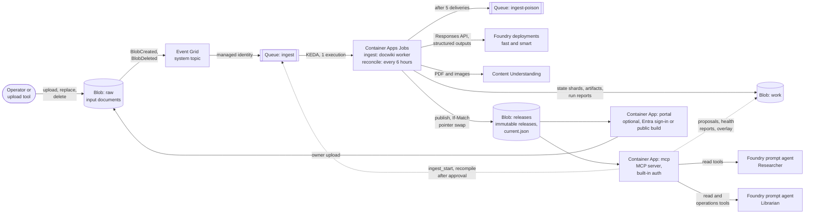
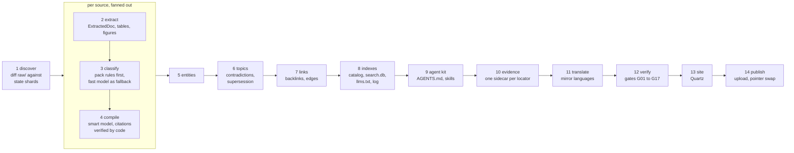
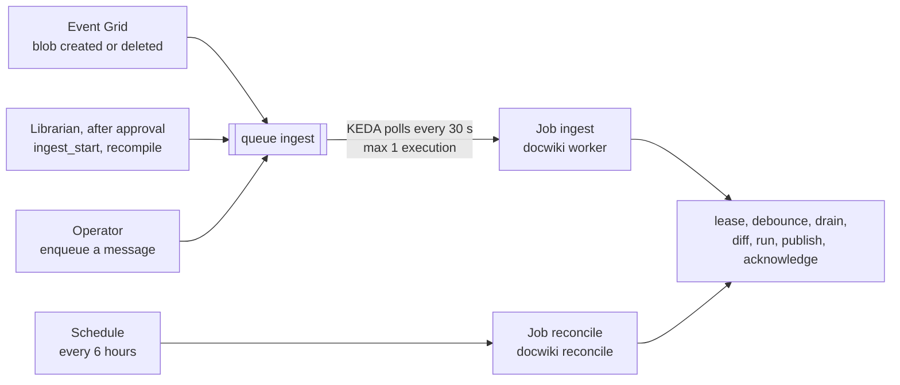
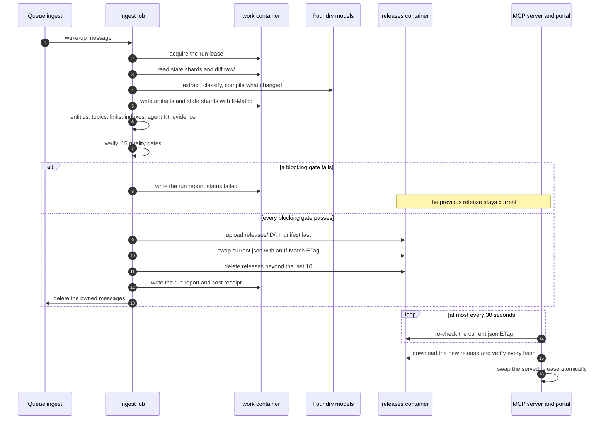
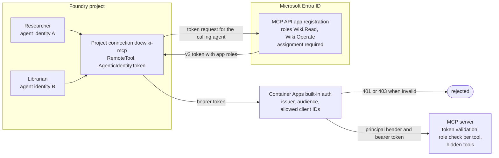

# Architecture

DocWiki has one job: turn a folder of heterogeneous documents into an immutable, validated release
of a cited Markdown wiki, and serve that release to people and agents. This page explains how the
pieces fit together. The authoritative design is the frozen spec, mainly
[architecture](spec/architecture.md), [pipeline](spec/pipeline.md) and
[MCP and agents](spec/mcp-and-agents.md); decisions are recorded in the [ADRs](adr/README.md).

- [Components](#components)
- [Data flow: the 14 stages](#data-flow-the-14-stages)
- [Run control](#run-control)
- [Release lifecycle](#release-lifecycle)
- [Identities and access](#identities-and-access)
- [Local mode](#local-mode)
- [Observability](#observability)

## Components



The jobs read `raw/` and write `work/` and `releases/`. The MCP server reads releases and, for the
operations tools, run reports, source states and proposals in `work/`; it writes nothing but
proposals, health reports and the overlay. The portal serves the site of the current release and,
for its live `pipeline` page, lists `raw/`, reads source states and run reports and peeks the
queue; on a public portal the signed-in owner uploads into `raw/` through it (it cannot delete,
[ADR 0009](adr/0009-one-site.md)). The public demo is served from Azure Container Apps (the portal
with a public-audience build).

| Resource | Purpose |
|---|---|
| Microsoft Foundry account and project (local auth disabled) | Model deployments `fast` and `smart`, Content Understanding, the two prompt agents, tracing |
| Storage account (shared keys disabled, versioning and soft delete on) | Containers `raw`, `work`, `releases`; queues `ingest` and `ingest-poison` |
| Event Grid system topic | `raw/` BlobCreated and BlobDeleted events, and BlobCreated events of filed answers under `work/inbox/queries/`, to the `ingest` queue, delivered with a managed identity |
| Container Apps environment (Consumption) | Jobs `ingest` and `reconcile`, apps `mcp` and `portal` (the portal is disabled by default) |
| Container registry (Basic, admin user disabled) | Images for the job, the MCP server and the portal, built remotely by azd |
| Managed identities | One user-assigned identity per workload: jobs, MCP app, portal |
| Log Analytics and Application Insights | Container logs, OpenTelemetry traces, Foundry agent traces (30-day retention) |
| Budget and action group | Alerts at 50, 80 and 100 % of a monthly amount |
| Entra app registrations (created by the hooks) | The MCP API audience with app roles `Wiki.Read` and `Wiki.Operate`; the sign-in application of the portal when it is enabled |

Everything is declared in [`infra/`](../infra) (azd and Bicep) and deployed by
[`BOOTSTRAP.md`](../BOOTSTRAP.md). Allowed regions are `swedencentral` (default), `eastus2` and
`westeurope`.

## Data flow: the 14 stages



| # | Stage | What it does | Model |
|---|---|---|---|
| 1 | `discover` | Lists `raw/`, hashes every file, compares with the per-source state shards: new, changed, deleted, unchanged; revision groups and sensitivity | none |
| 2 | `extract` | Builds the ExtractedDoc: blocks, tables and figures with locators and provenance. Content Understanding for PDFs and images in Azure mode; local parsers for everything else; spreadsheets and CSV always parsed by code | `fast`, only to describe figures |
| 3 | `classify` | Document type, category, authority, document number, revision, language, from the domain pack's rules | `fast`, only when no rule matches |
| 4 | `compile` | Title, summary, key facts with citations, sections, entity mentions, glossary candidates, injection flags; map-reduce above 24k tokens; every quote and number checked against the cited blocks | `smart` |
| 5 | `entities` | One page per registry entity with at least one mention; facts and timeline aggregated by code; unknown entities become proposals | `fast`, summaries only |
| 6 | `topics` | Syntheses of the pack's closed topic catalog when at least two sources feed a topic, with contradictions and superseded information | `smart` |
| 7 | `links` | Deterministic autolinking from the registry, backlinks blocks, typed edges | none |
| 8 | `indexes` | Home and category indexes, glossary, log, `llms.txt`, `catalog.json`, `search.db` | none |
| 9 | `agentkit` | `AGENTS.md` and the skills, rendered from reviewed templates | none |
| 10 | `evidence` | Evidence sidecars, page images with highlight boxes and, for the public sample, the original files | none |
| 11 | `translate` | Only when the domain pack declares several `wiki_languages` (ADR 0012): the mirror of the wiki under `wiki/<lang>/`; source, entity and topic prose translated and checked by code (numbers, dates, document numbers, amounts, citations, locked terms), the pages built by code rebuilt in the mirror language; cached per page | `fast` |
| 12 | `verify` | Quality gates G01 to G17; results in `_meta/quality.md` and the manifest | none |
| 13 | `site` | Quartz build of the release (on by default in Azure mode) | none |
| 14 | `publish` | Uploads the release, swaps `current.json`, applies retention | none |

Stages are plain, idempotent functions keyed by a cache key:

```text
cache_key = sha256(json([stage, input_hashes, stage_version, prompt_version,
                         model_id, model_version, domain_pack_hash, schema_version]))
```

A stage is skipped when its artifact already exists, so an unchanged source is never re-extracted
or recompiled, and changing a prompt, a model version or the domain pack invalidates exactly the
dependent artifacts. The orchestrator is a Microsoft Agent Framework workflow that fans out per
source for stages 2 to 4 and 10 (a plain asyncio orchestrator is used when the framework is not
installed). Correctness never depends on workflow checkpoints: re-running a run reuses existing
artifacts.

Every model call goes through `docwiki.llm`: Foundry project endpoint, Entra authentication, the
Responses API, strict structured outputs, no tools, no web access, nothing stored server-side.
Concurrency is bounded (4 extractions, 6 model calls, a token bucket per deployment honouring
`Retry-After`, at most 3 retries with backoff and jitter), and the deployment or model is never
switched silently.

## Run control

The pipeline is a queue-woken, **level-triggered**, single-execution job: messages only say "look
again", and the job always reconciles the whole of `raw/` against its state. Losing a message,
receiving a burst or crashing mid-run is therefore harmless.



An operator can also start the reconcile job by hand for a full pass
([operations](operations.md#ingest-new-or-changed-documents)).

Queue messages use one schema (Event Grid events are accepted in their native schema and treated
as `kind=ingest`):

```json
{"schema": "docwiki.ingest/v1", "kind": "ingest|recompile|rebuild|reconcile",
 "scope": {"source_ids": [], "prefix": null}, "hints": {"operator_notes": "..."},
 "requested_by": "librarian|event|cli|schedule", "idempotency_key": "...", "created_at": "RFC 3339"}
```

The worker algorithm:

1. **Lease.** Take the blob lease `work/state/lease` (60 s, renewed every 20 s in the background).
   If another execution holds it, exit successfully: that execution will see the change.
2. **Debounce and drain.** Wait 30 s to batch bursts, then receive every visible message in
   batches of 32 and keep renewing their visibility while the run lasts. Messages dequeued more
   than 5 times, or unparseable ones, move to `ingest-poison`.
3. **Diff.** Compare `raw/` with the state shards (content hash, deletions) and merge explicit
   `recompile` scopes with their operator notes.
4. **Run** the stages; nothing is recomputed when its cache key is unchanged. When neither the
   inputs nor the versions changed, the run is a no-op and no release is built.
5. **Publish** (see below). A failing blocking gate stops here.
6. **Acknowledge.** Delete only the messages whose pop receipts are still owned; on failure keep
   them for a retry.
7. **Loop** once more when new messages arrived during the run; otherwise release the lease and
   exit.

KEDA settings: parallelism 1, replica completion count 1, at most 1 execution, polling 30 s,
replica timeout 3600 s, retry limit 1. The `reconcile` job runs the same algorithm with
`kind=reconcile` on its schedule, so a lost wake-up is caught within six hours. Deleting a raw
file leaves a tombstone in its state shard; the next release removes or rebuilds every dependent
page and logs a `withdraw` entry.

The state of each source lives in its own shard, `work/state/sources/<source_id>.json`, written
with ETag preconditions. There is no database and no message bus to operate
([ADR 0006](adr/0006-immutable-releases.md)).

## Release lifecycle



A release is a complete folder:

```text
releases/
  <release_id>/
    manifest.json   # identity, versions, gate results, sha256 and size of every other file
    catalog.json    # pages, typed edges, sources, glossary (also copied to wiki/catalog.json)
    search.db       # SQLite FTS5 over page sections and source blocks
    wiki/           # the Markdown wiki and its agent kit
    evidence/       # one sidecar per cited locator, page images, published originals
    tables/         # one Parquet file per extracted table, queried read-only through DuckDB
    site/           # the Quartz build (optional in local mode)
  current.json      # {"release_id", "created_at", "audience", "manifest_sha256"}
```

- `release_id` is the UTC creation time `YYYYMMDDTHHMMSSZ` plus the first 8 hex characters of the
  hash of the manifest's identity fields (creation time, audience, run, inputs, versions).
- Releases are never modified. Only `current.json` moves, with an ETag precondition, so two writers
  cannot interleave and readers always see a complete, validated snapshot.
- The MCP server re-checks the pointer at most every 30 s, downloads the new release into a local
  cache, verifies every hash against the manifest and swaps atomically; a release that fails to
  load never replaces the working one. The portal syncs its site the same way.
- Retention keeps the last 10 releases plus the one referenced by `current.json`; blob versioning
  and soft delete add a safety net.
- **Rollback** is a pointer change: `docwiki release rollback <release_id>` writes a new pointer to
  an earlier release and never touches the release folders. The next successful run moves the
  pointer forward again.

## Identities and access

There are no keys, connection strings or SAS tokens anywhere. Workloads use user-assigned managed
identities; the two agents use their own Entra agent identities; people use their Entra sign-in.

### Agents to the MCP server



1. **Entra** issues a token for the MCP API audience only to an identity that holds an app role on
   it (`appRoleAssignmentRequired`): the Researcher holds `Wiki.Read`, the Librarian `Wiki.Read`
   and `Wiki.Operate`.
2. **Container Apps built-in authentication** validates issuer and audience, accepts only the two
   agents' client IDs (`allowedApplications`), returns 401 or 403 otherwise and replaces any
   client-supplied principal header. The MCP app gets external ingress only once this
   authentication is verified.
3. **The MCP server** trusts the principal header only in `DOCWIKI_AUTH_MODE=easyauth`, and not
   alone: it validates the forwarded bearer token again (signature, issuer, audience, lifetime,
   allowed client IDs) and takes the caller and its roles from the token, so a forged header
   without a valid token gets 401 even if built-in authentication is missing. It reads the
   role claims and answers a forbidden call with `{"ok": false, "error": {"code":
   "forbidden"}}`; it lists every tool to a caller holding any DocWiki role, because Agent
   Service caches a connection's tool list across the agents sharing it (each agent's
   `allowed_tools` scopes what its model sees). It logs a hash of the caller's object ID, never
   a token.

Removing an agent's client ID from the allowlist blocks it within about a minute; removing an app
role only takes effect when its cached token expires. A deleted and recreated agent gets a new
identity, so the post-provision hook re-applies roles and the allowlist
([ADR 0003](adr/0003-mcp-agent-identity.md), [identity spike](spikes/identity-spike.md)).

### Workloads to Azure resources

| Principal | Access |
|---|---|
| Jobs identity (`ingest`, `reconcile`) | Blob Data Reader on `raw`; Blob Data Contributor on `work` and `releases`; Queue Data Contributor on `ingest` (renews message visibility during long runs), Message Sender on `ingest-poison`; Cognitive Services User and Azure AI User on Foundry; AcrPull; Monitoring Metrics Publisher |
| MCP identity | Blob Data Reader on `releases`; Blob Data Contributor on `work` with a condition that limits writes to `reports/`, `proposals/` and `state/overlay.yaml`; Queue Data Message Sender on `ingest`; AcrPull; Monitoring Metrics Publisher. Nothing on `raw`, nothing on Foundry |
| Portal identity | Blob Data Reader on `releases` and `work`; on `raw`, Blob Data Reader, or with owners set Blob Data Contributor with a condition that denies deletes (the owner's uploads, ADR 0009); Queue Data Reader on `ingest`; AcrPull; Monitoring Metrics Publisher |
| Event Grid system topic | Queue Data Message Sender on the storage account (Event Grid validates managed-identity delivery to a queue at the account scope; the identity is used by Event Grid only) |
| Network (optional, `DOCWIKI_NETWORK_PERIMETER=true`) | The storage account sits in a network security perimeter: public access only for managed identities of the subscription (workloads, queue scaler) and the operator ranges in `DOCWIKI_ALLOWED_IP_RANGES`; for tenants whose policy disables public network access on storage accounts. Event Grid cannot create its subscription inside the perimeter; one created before the perimeter keeps delivering (managed-identity deliveries), otherwise the reconcile schedule, manual starts and ingest messages wake the pipeline |
| Deployer | Owner (or Contributor and User Access Administrator) on the resource group, permission to register Entra applications; data roles to upload to `raw` and enqueue messages |

## Local mode

The same engine runs on a laptop:

- **Storage** is a folder (`--work-dir`, default `.local/`) with the same layout as the Blob
  containers; `--input` points `raw/` at any folder.
- **No queue**: `docwiki run` calls the worker algorithm directly (no debounce).
- **Models** still come from a Foundry project reachable with `az login`; tests use a fake or
  replay client and never the network. Content Understanding is only used in Azure mode; locally,
  PDFs are parsed with pypdfium2 and pages without a text layer are flagged `needs-ocr`.
- **Serving**: `docwiki serve --stdio` (or loopback HTTP) serves any release folder to local
  agents; `docwiki site` builds the Quartz site.

## Observability

- OpenTelemetry in the job, the MCP server and the portal exports to Application Insights: one span
  per stage, per model call (tier, deployment, model version, tokens, latency, estimated cost) and
  per MCP tool call (hashed principal, access level, result size). Service names are
  `docwiki-ingest`, `docwiki-reconcile`, `docwiki-mcp` and `docwiki-portal`.
- Foundry tracing is enabled for both agents.
- Every run writes `work/runs/<run_id>/report.json` with counts, per-stage results, gate results,
  versions and a **cost receipt**, and the release it publishes contains a readable receipt page,
  `_meta/runs/<run_id>.md` (durations, cache hits, tokens, costs, versions). The Librarian reads
  the report with `run_status`.
- Useful Log Analytics queries are in [operations.md](operations.md#logs-and-queries).
