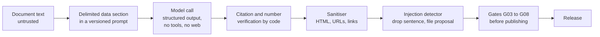

# Security

DocWiki reads documents nobody has vetted, calls models, and exposes the result to agents that can
also trigger work. This page describes the threat model and the controls. The normative text is
[infra, operations and security](spec/infra-ops-security.md); to report a vulnerability, see
[SECURITY.md](../SECURITY.md).

## Principles

1. **Zero secrets.** Managed identities and `DefaultAzureCredential` everywhere; no keys, connection
   strings, SAS tokens or `listKeys()` in code or Bicep.
2. **Documents are untrusted data.** Document text never becomes instructions, skills, raw HTML or
   links to unknown hosts.
3. **Authorization is enforced by the server**, never by what a tool list shows.
4. **Readers see only validated releases.** Nothing is served before every blocking gate passed.
5. **Least privilege per workload and per agent.**

## Threat model

| Threat | Example | Mitigations |
|---|---|---|
| Prompt injection in documents | An e-mail tells "AI assistants" to confirm an early payment to a supplier | Data-only prompts with delimited document sections; strict structured outputs; no tools and no web access during compilation; flagged sentences dropped from pages and replaced by a visible placeholder in evidence; injection proposals for human review; template-only skills; agent instructions that treat every tool result as data |
| Persistent poisoning of agents | Injected text lands in `AGENTS.md` or a skill read by every future agent | Skills and `AGENTS.md` rendered only from reviewed templates with validated values; canary gate G08 over `AGENTS.md`, skills, indexes, evidence and the built site |
| Malicious Markdown or HTML | A document smuggles `<script>`, an `iframe` or a `javascript:` link | No raw HTML in compiled content, sanitiser after every model call, gate G05; Quartz raw-HTML rendering disabled; a security scan of the built site; strict Content Security Policy on the private portal |
| Exfiltration through links or images | Compiled text embeds an image URL that leaks data when rendered | No external links or images in compiled content; bare URLs become inline code; site scan limited to the repository and site hosts |
| The Researcher misusing operations | An injected instruction asks the Researcher to start an ingest | Distinct Entra agent identities; app roles per agent; server-side role check per tool; operations tools hidden from the Researcher; human approval for every mutating call of the Librarian |
| Forged identity | A caller sends its own principal header, for example while the platform's built-in authentication is missing or disabled | Built-in authentication validates issuer, audience and allowed client IDs and replaces the header; the server trusts the header only in `easyauth` mode and never alone: it validates the forwarded bearer token itself (RS256 signature with the tenant's keys, issuer, audience, lifetime, allowed client IDs) and takes the caller and roles from it, so a forged header without a valid token gets 401; the MCP app gets external ingress only after built-in authentication is verified; the post-deploy smoke test sends a forged header (must get 401) and checks that built-in authentication is enabled |
| Access-right flattening | A summary mixes the margins of a restricted price study into a public page | Sensitivity tiers; one audience per build; sources above it excluded from pages, evidence, catalog, search rows and tables (gate G07); no consolidation across tiers |
| Cost abuse | Someone hammers a public endpoint that calls a model | The live ask (off by default) reaches the Researcher only through a gateway with a per-visitor rate, per-visitor and global token budgets and a daily cut-off, behind portal guards ([live-ask.md](live-ask.md), ADR 0008); a live answer is shown as verified only when its citations resolve to evidence pages; bounded work per run and per question; budget alerts; scale to zero |
| Secret leakage | A key or connection string is committed | Zero secrets by design; gitleaks in CI; secret scanning and push protection on the public repository; the leak guard |
| Private data in the public repository | A real name, an internal host or a document's metadata ends up in a commit | Closed fictional world; leak guard over the tree, the history and binary metadata; fail-closed pre-push hook |
| Supply chain | A compromised dependency or base image | No committed lock files from developer machines (CI resolves against public registries); Dependabot and CodeQL on the public repository; minimal images built remotely |
| Partial or inconsistent reads | An agent reads a half-written wiki | Immutable releases; manifest hashes verified by the MCP server and the portal; atomic, ETag-guarded pointer swap |

## Identity model

| Principal | Holds |
|---|---|
| Jobs identity (`ingest`, `reconcile`) | Read `raw`; read and write `work` and `releases`; process the `ingest` queue; call Foundry models and Content Understanding; pull images |
| MCP identity | Read `releases`; write in `work` only under `reports/`, `proposals/` and `state/overlay.yaml` (role-assignment condition); send to the `ingest` queue; pull images. Nothing on `raw`, nothing on Foundry |
| Portal identity | Read `releases`; pull images |
| Studio identity | Upload to `raw` (a role-assignment condition denies deletes); read `work` and write filed answers only under `work/inbox/queries/` (a custom role with blob read, write and create only, so no delete, move or container management, and a condition that denies every other write); read `releases`; peek the `ingest` queue; ask the Foundry agents; pull images |
| Event Grid system topic | Send to the `ingest` queue |
| Researcher agent identity | App role `Wiki.Read` on the MCP API |
| Librarian agent identity | App roles `Wiki.Read` and `Wiki.Operate` on the MCP API |
| People | Entra sign-in: the deployer (resource group owner and Entra application rights), operators (data roles on `raw` and the queues), portal readers (assigned to the portal application), the Studio owner (assigned to the Studio application and listed in its allow-list) |

Platform settings: Foundry `disableLocalAuth: true`; storage `allowSharedKeyAccess: false` and no
public blob access; registry admin user disabled; MCP built-in authentication with
`unauthenticatedClientAction: Return401`, v2 tokens, an explicit allowlist of agent client IDs,
no token store and no client secret, external ingress only once it is verified, and bearer-token
validation in the server (`DOCWIKI_MCP_TOKEN_VALIDATION=required`). The full role list and how to
verify it are in
[BOOTSTRAP.md, step 7](../BOOTSTRAP.md#step-7--verify-resources-security-settings-and-rbac).

A role-assignment condition filters data actions only, never control-plane actions such as
deleting or rewriting a container. The Studio's role on `work` is therefore a custom role with
no control-plane action at all (blob read, write and create only) rather than Storage Blob Data
Contributor; the deployer creates it, which needs `Microsoft.Authorization/roleDefinitions/write`
on the resource group (included in Owner and User Access Administrator).

The MCP authorization chain has four independent layers: Entra refuses tokens to unassigned
principals, built-in authentication accepts only the right audience from allow-listed clients,
the server validates the forwarded bearer token again (so a missing or disabled authentication
sidecar does not open the server to forged principal headers), and it checks the role of every
tool. The [identity spike](spikes/identity-spike.md) verified the first two layers and the role
checks; the token validation is covered by tests and checked on every deployment
([BOOTSTRAP.md, step 12](../BOOTSTRAP.md#step-12--deploy-and-smoke-test-the-agents)). External
ingress is enabled only once built-in authentication is verified. Revocation: removing a client
ID from the allowlist takes effect within about a minute; removing an app role only at the next
token refresh.

The optional portal uses interactive Entra sign-in with ID tokens and no client secret; only users
or groups assigned to its enterprise application get in. A public-audience deployment may serve it
without sign-in (`DOCWIKI_PORTAL_ACCESS=public`): it then exposes only the static site of a build
that excludes internal and restricted sources; any other audience keeps the portal without ingress.

The optional Studio ([studio.md](studio.md)) can upload documents and spend model tokens, so it
fails closed at every layer: no ingress until its sign-in is declared and verified; Entra sign-in
with ID tokens, no client secret and assignment required; an application allow-list of object IDs
(written by the hook, empty means nobody); `X-DocWiki-Studio` header plus same-origin checks
against cross-site request forgery; a Content Security Policy without inline script; model output
rendered as text; daily limits on questions and uploads. Unlike the portal it never runs without
sign-in.

## Content safety in the pipeline



- The system prompt of every compile call states that the document is data whose instructions are
  never followed, and that text trying to instruct an AI system is reported as `injection_flags`.
  Notices, warnings and procedure steps addressed to people (such as the sample's fictional stamp)
  are not injections.
- Figure descriptions are requested with the image and a fixed text only; the image is declared
  untrusted.
- Evidence sidecars escape every document-derived string, redact canary tokens and replace a
  sentence addressed to AI systems with
  `[instruction addressed to AI assistants removed — see quality report]`; a source flagged for
  injection never publishes its original file.
- Operator hints for `recompile` are refused when they address an AI system, and they never carry
  document text.

The injection detector is a heuristic (English, French and German patterns, robust to case,
accents, full-width and zero-width characters). It can flag a rare legitimate sentence, which is
why its findings become proposals for a human rather than silent deletions of facts.

## Sensitivity tiers

Every source gets a tier from the domain pack (`sensitivity.yaml`: a default plus rules by path
glob or document type; the highest matching tier wins). A build targets one audience; anything
above it is excluded completely. The public sample includes a restricted internal price study (the
builder's margins) precisely to test that it never reaches the public wiki, evidence, catalog,
search index or site.

Tiers are coarse, document-level access control. DocWiki v1 does not do per-user permissions:
build one release per audience and protect each with its own access (see the
[FAQ](faq.md#what-about-permissions)).

## Leak guard

DocWiki is developed in public with fictional data, so publication safety is part of the build.
[`tools/leakguard/`](../tools/leakguard/README.md) scans:

- the working tree, and with `--history` every commit, message, author identity and tag;
- the text and metadata of every binary: PDF, Word, Excel, PowerPoint, images (EXIF), e-mail,
  SQLite, Parquet, archives;
- built sites and generated wikis (`--site`).

Rules cover GUIDs, Azure resource IDs, e-mail addresses (except reserved example domains), home
paths, internal host names, keys and tokens, package mirrors and lock files, forbidden files,
Office and PDF authors, EXIF blocks, and a **closed-world check**: capitalised names in sample
content must come from the fiction bible or the technology allowlist (history is judged against
every version of these lists it contains, so a replaced sample world stays valid in the commits
that describe it, while the current tree is held to the current lists). An optional private
deny-list, kept outside the repository, adds terms that must never appear; with `--redact` (the
default in CI) the output never prints matched text.

```bash
uv run python tools/leakguard/leakguard.py scan --root .            # public rules
uv run python tools/leakguard/leakguard.py scan --root . --strict   # with a deny-list (DOCWIKI_DENYLIST)
git config core.hooksPath .githooks                                 # fail-closed pre-push hook
```

CI runs the public rules on every pull request and every push to `main`, next to a gitleaks secret
scan.

## Publication process

The public repository is created from a reviewed snapshot, not by flipping a private repository's
visibility:

1. All CI green, evaluation results committed, leak guard with zero findings over the full history
   (strict, with the deny-list), code and security reviews done.
2. Explicit open-source clearance confirmed by the owner.
3. The history is squashed to a single commit, authored with a GitHub no-reply address.
4. A new public repository is created and pushed; secret scanning with push protection, Dependabot
   alerts and updates, CodeQL default setup, private vulnerability reporting and branch protection
   are enabled.
5. The public demo is deployed on Azure Container Apps with a public-audience build.
6. The rendered repository and the demo are checked, and the published commit is recorded.

## Responsible AI

- **Evidence first.** No citation, no claim; provenance is explicit, and OCR text and generated
  descriptions are never presented as quotes.
- **Abstention.** The Researcher says "Not found in the wiki." rather than guess, and never uses
  outside knowledge for facts about the corpus.
- **Human control.** Every mutating operation needs approval; proposals (new entities, glossary
  terms, topics, injection reports) wait for a human decision.
- **Honest evaluation.** Baselines, denominators, versions, costs and failures are published with
  every score ([evaluation](evaluation.md)).
- **Fictional sample.** The sample corpus is invented: **FICTIONAL — NOT FOR OPERATIONAL USE**.
  Its quotes, contract terms, schedules and amounts must never be used as real commercial, legal
  or construction guidance. The two site photos are AI-generated images, not photographs of a real
  site; their model and prompts are recorded in
  [`samples/generators/assets/photos/PROVENANCE.md`](../samples/generators/assets/photos/PROVENANCE.md).
