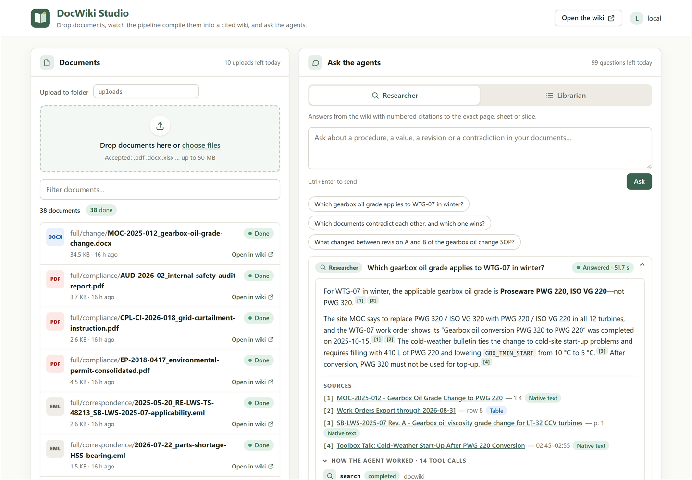
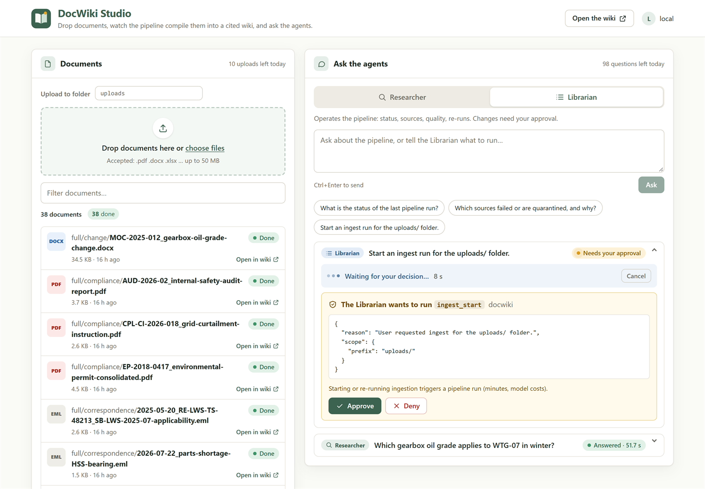
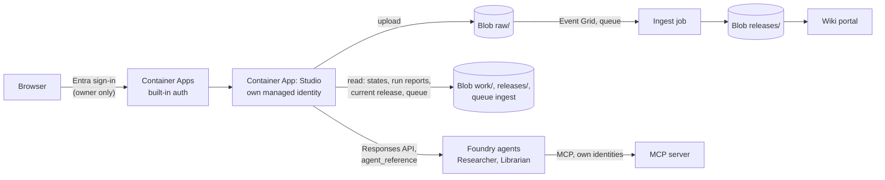

# DocWiki Studio

DocWiki Studio is the visible application around the pipeline and the two agents: one signed-in
page where you add documents, watch the ingest job compile them into a new release, and ask the
Researcher and the Librarian. It runs as its own Azure Container App next to the wiki portal and
reuses everything else unchanged: the upload is the same `raw/` drop that triggers the pipeline,
and the questions go to the same Foundry agents through the project's Responses API.

> **Status: demo / proof of concept**, like the rest of DocWiki. One replica, questions kept in
> memory, owner-only access.



## What you can do

| Panel | What it shows | What it does |
|---|---|---|
| **Documents** | Every file in `raw/` with its pipeline status (`new`, `pending`, `done`, `failed`, `quarantined`, `deleted`), the failing stage and error, and a link to its wiki page | Upload files (drag and drop) into a folder of `raw/`; replacing a file starts a new revision |
| **Pipeline** | The served release (sources, pages, link to the wiki), the ingest queue, and the last ten run reports: stages, quality gates, counts and the cost receipt | Read only |
| **Ask** | The **Researcher**: cited answers whose `[n]` markers open the exact page, sheet rows, slide or transcript cue. The **Librarian**: run status, sources, quality, proposals | Every Librarian call that changes something (`ingest_start`, `recompile`, `decide_proposal`) waits for **Approve** or **Deny** in the page |

Each answer ends with a receipt (agent version, tool calls, tokens, latency) and a collapsible
"How the agent worked" trace of its tool calls.



## How it works



- **Uploads take the pipeline's normal path.** The Studio writes `raw/<folder>/<file>`; Event Grid
  turns the new blob into a queue message and KEDA starts the ingest job. Expect about a minute
  before the run starts (queue polling and the debounce window), then the per-document status
  moves from `new` to `pending` to `done`.
- **Questions run in the background.** `POST /api/ask` returns at once with a question ID; the page
  polls it every two seconds. Long answers never hit the 240-second request limit of Container
  Apps ingress.
- **Approvals pause the agent.** When the Librarian calls a mutating tool, Foundry returns an
  `mcp_approval_request`; the Studio parks it until you decide, then continues the response with
  your `mcp_approval_response`. Without a decision within ten minutes the call is denied.

## Access and safety

The Studio can write to `raw/` and spend model tokens, so it is built to fail closed.

| Layer | Protection |
|---|---|
| Network | External ingress only once its sign-in is declared and verified (Bicep and the postprovision hook); disabled, the app is dormant at zero replicas |
| Sign-in | Container Apps built-in authentication with a single-tenant Entra app registration: ID tokens only, **no client secret**, assignment required, the deployer assigned. Unauthenticated requests are redirected to sign-in; only `/livez` and `/healthz` (static liveness answers) are excluded |
| Application | Every `/api` call needs the principal headers injected by the platform **and** an object ID listed in `DOCWIKI_STUDIO_ALLOWED_PRINCIPALS` (written by the hook: the deployer). An empty list lets nobody in |
| Requests | Writes need the `X-DocWiki-Studio: 1` header and a same-origin request (`Origin`, `Sec-Fetch-Site`); there is no CORS. Uploads accept only the pipeline's file types, safe relative paths and 50 MB |
| Browser | `Content-Security-Policy: script-src 'self'` (no inline script or style, no third party), `frame-ancestors 'none'`. Model output is rendered as text; links are built only from validated wiki paths |
| Identity | `id-docwiki-studio-*`: Storage Blob Data Contributor on `raw` **with a condition that denies deletes**, Storage Blob Data Reader on `work` and `releases`, Storage Queue Data Reader on `ingest`, Azure AI User on the Foundry account |
| Cost | One question at a time, 100 questions and 10 uploads per day, a 20-minute deadline per question, and a confirmation before each upload: a new or changed document starts a pipeline run (about 15 minutes and 10 USD on the sample corpus, see [cost](cost.md)) |

## Enable it on Azure

```bash
azd env set DOCWIKI_ENABLE_STUDIO true
azd provision          # identity, roles and the app (no ingress); the hook then registers the
                       # sign-in app, assigns you, writes the allow-list, applies auth, opens ingress
azd deploy studio      # builds the image in the registry and rolls it out
azd env get-value DOCWIKI_STUDIO_URL
```

Open the URL and sign in with the account that ran `azd provision`. The hook prints
`studio ready at <DOCWIKI_STUDIO_URL> (Entra sign-in, owner only)` when it is done.

| Setting (azd environment) | Default | Effect |
|---|---|---|
| `DOCWIKI_ENABLE_STUDIO` | `false` | Deploy the Studio |
| `DOCWIKI_STUDIO_ALLOWED_PRINCIPALS` | the deployer (set by the hook) | Comma-separated Entra object IDs allowed in |
| `DOCWIKI_STUDIO_MIN_REPLICAS` | `1` | `1` keeps questions and approval waits in memory and avoids cold starts (about 0.5 vCPU idle); `0` scales to zero |
| `DOCWIKI_GRAPH_TOKEN_SOURCE` | unset | `azd`: when the Azure CLI token is refused by Microsoft Graph (continuous access evaluation), the hook uses the azd sign-in for Graph, after checking it is the same account and tenant |

The question and upload limits are container settings with defaults
(`DOCWIKI_STUDIO_DAILY_QUESTIONS`, `DOCWIKI_STUDIO_DAILY_UPLOADS`, `DOCWIKI_STUDIO_MAX_UPLOAD_MB`,
`DOCWIKI_STUDIO_APPROVAL_TIMEOUT_SECONDS`, `DOCWIKI_STUDIO_QUESTION_TIMEOUT_SECONDS`).

**Add someone.** Assign them to the enterprise application `docwiki-studio-<env>` in Microsoft
Entra ID, append their object ID to `DOCWIKI_STUDIO_ALLOWED_PRINCIPALS`, then run `azd provision`.

**Turn it off.** `azd env set DOCWIKI_ENABLE_STUDIO false` and `azd provision`: the app loses its
ingress and stays dormant at zero replicas. `azd down` deletes the app registration with the rest.

## Run it on your workstation

`docwiki studio --local` serves the same app on `http://127.0.0.1:8090` with your `az login`
instead of a managed identity; `--local` skips the sign-in checks and only binds the loopback
interface (the CSRF checks stay on). Point it at a deployed environment:

```powershell
$env:DOCWIKI_MODE = "azure"
$env:DOCWIKI_STORAGE_ACCOUNT = azd env get-value DOCWIKI_STORAGE_ACCOUNT
$env:DOCWIKI_FOUNDRY_PROJECT_ENDPOINT = azd env get-value DOCWIKI_FOUNDRY_PROJECT_ENDPOINT
$env:DOCWIKI_STUDIO_WIKI_URL = azd env get-value DOCWIKI_PORTAL_URL
uv run docwiki studio --local
```

Your account needs the deployer's data roles (granted by Bicep when `grantDeployerDataAccess` is
on) and, with a network perimeter, your IP in `DOCWIKI_ALLOWED_IP_RANGES`.

Without Azure, `uv run python tests/studio/studio_preview.py` serves the Studio on seeded data
with canned agent answers at `http://127.0.0.1:8091`.

## A five-minute demo

1. **Before the audience arrives**, open the portal and the Studio and ask one question: it wakes
   the MCP server and the portal (each can take about 30 seconds from zero). To show a fresh
   release, upload the new document 20 minutes before.
2. **Documents**: every source compiled, each one opening its wiki page.
3. **Ask the Researcher** "Which gearbox oil grade applies to WTG-07 in winter?": the citations open
   the service bulletin page, the change record and the work-order row. Expand "How the agent
   worked" to show the search, page reads and evidence checks.
4. **Ask the Librarian** "Start an ingest run for the uploads/ folder": it asks for approval. Deny
   it, or approve it: with nothing changed the run is a no-op that costs nothing.
5. **Pipeline**: the run timeline, the quality gates and the cost receipt of the last compilation.

## Check a deployment (three minutes, as the owner)

Without signing in, check that the Studio's managed identity reaches the storage and the agents:

```bash
az containerapp exec --name $(azd env get-value DOCWIKI_STUDIO_APP_NAME) \
  --resource-group $(azd env get-value AZURE_RESOURCE_GROUP) \
  --command "python -m docwiki.studio --check"
# {"storage": true, "agents": true, "queue_readable": true, "ok": true}
```

Then, as the owner:

1. Open the Studio URL in a private window: you are sent to Microsoft Entra sign-in.
2. Sign in as the owner: the page loads, the documents and the served release appear.
3. Ask the Researcher a sample question: an answer with linked citations comes back.
4. Ask the Librarian for the last run's status: it answers without asking for approval.
5. Sign in with another account (or remove yourself from the allow-list): access is refused.

## Limits

- One replica keeps the questions in memory: a restart forgets questions in flight (the page says
  so and you ask again).
- Answers are not streamed: they appear when the agent is done (usually 20 to 110 seconds; the
  page shows the elapsed time).
- The Studio cannot delete documents: delete them in the storage account (the pipeline then
  withdraws them from the wiki).
- The agents and the pipeline share the `smart` model deployment: a question asked during a run is
  slower and may be throttled.
