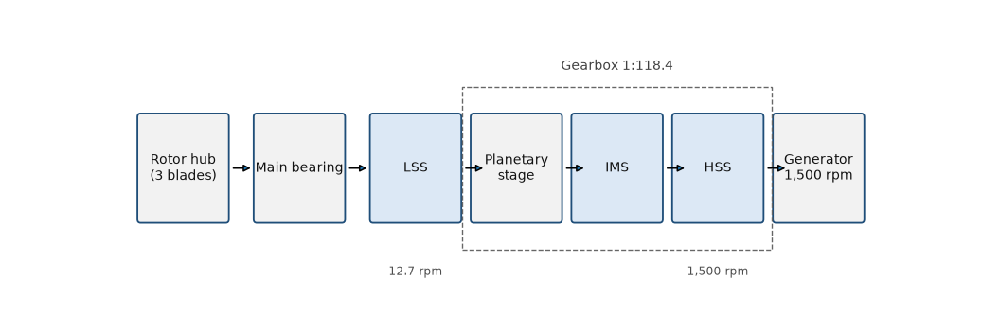

# Gearbox Fundamentals for Wind Technicians — slide 2

Source page: [Gearbox Fundamentals for Wind Technicians](../../sources/gearbox-fundamentals.md) · Original file: [original.pptx](original.pptx) · Provenance: ✓ quote verified (native text) · Figures: generated description (model output, not verified)

## Text

> The gearbox raises 12.7 rpm at the rotor to 1,500 rpm at the generator.

## Figure f01

> **Generated description** — written by a model from the figure image; not verified against the source.
>
> A horizontal block diagram shows a wind turbine drivetrain from left to right: Rotor hub (3 blades), Main bearing, LSS, Planetary stage, IMS, HSS, and Generator 1,500 rpm, with arrows connecting each block. A dashed bracket labeled Gearbox 1:118.4 spans the Planetary stage, IMS, and HSS, and small labels below indicate 12.7 rpm near the LSS and 1,500 rpm near the gearbox output/generator. The LSS, IMS, and HSS blocks are shaded light blue while the others are white with blue outlines.
