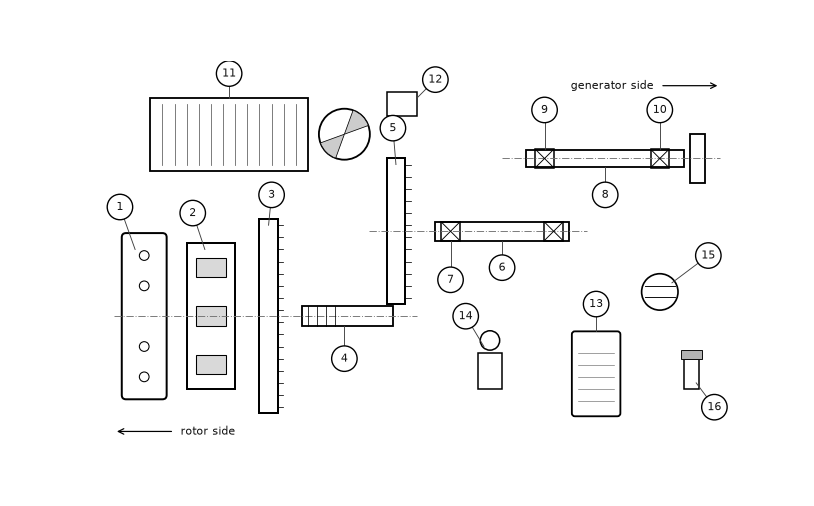

# Gearbox Fundamentals for Wind Technicians — slide 9

Source page: [Gearbox Fundamentals for Wind Technicians](../../sources/gearbox-fundamentals.md) · Original file: [original.pptx](original.pptx) · Provenance: ✓ quote verified (native text) · Figures: generated description (model output, not verified)

## Text

> Exploded view of the FGT-3200
>
> Item numbers as in the maintenance manual LWS-MM-GBX-32, figure 4-1.

## Figure f02

> **Generated description** — written by a model from the figure image; not verified against the source.
>
> A schematic technical diagram of a machine assembly with multiple numbered parts labeled 1 through 16. It shows several rectangular and cylindrical components, dashed centerlines, and arrows indicating “rotor side” on the left and “generator side” on the right, with the numbered callouts pointing to individual elements such as plates, shafts, blocks, and a circular disc.
