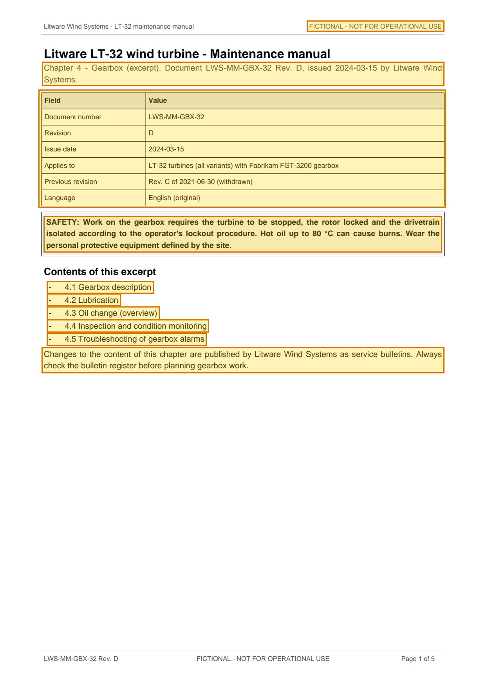

# LWS-MM-GBX-32 Rev. D — LT-32 Maintenance Manual Chapter 4 Gearbox Excerpt — p. 1

Source page: [LWS-MM-GBX-32 Rev. D — LT-32 Maintenance Manual Chapter 4 Gearbox Excerpt](../../sources/lws-mm-gbx-32-revd-gearbox-maintenance-manual-excerpt.md) · Original file: [original.pdf, p. 1](original.pdf#page=1) · Provenance: ✓ quote verified (native text)

## Text

> FICTIONAL - NOT FOR OPERATIONAL USE
>
> Chapter 4 - Gearbox (excerpt). Document LWS-MM-GBX-32 Rev. D, issued 2024-03-15 by Litware Wind Systems.
>
> SAFETY: Work on the gearbox requires the turbine to be stopped, the rotor locked and the drivetrain isolated according to the operator's lockout procedure. Hot oil up to 80 °C can cause burns. Wear the personal protective equipment defined by the site.
>
> \- 4.1 Gearbox description
>
> \- 4.2 Lubrication
>
> \- 4.3 Oil change (overview)
>
> \- 4.4 Inspection and condition monitoring
>
> \- 4.5 Troubleshooting of gearbox alarms
>
> Changes to the content of this chapter are published by Litware Wind Systems as service bulletins. Always check the bulletin register before planning gearbox work.

## Table t01

| Row | Field | Value |
| --- | --- | --- |
| 2 | Document number | LWS-MM-GBX-32 |
| 3 | Revision | D |
| 4 | Issue date | 2024-03-15 |
| 5 | Applies to | LT-32 turbines (all variants) with Fabrikam FGT-3200 gearbox |
| 6 | Previous revision | Rev. C of 2021-06-30 (withdrawn) |
| 7 | Language | English (original) |
