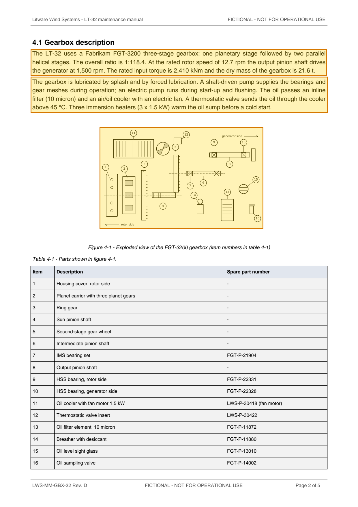
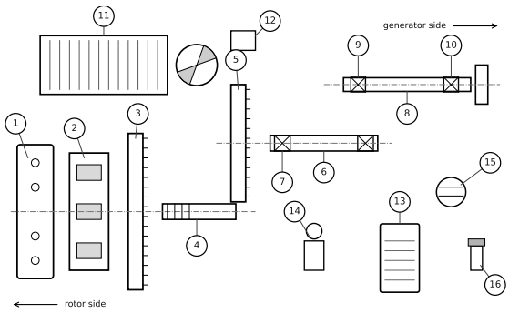

# LWS-MM-GBX-32 Rev. D — LT-32 Maintenance Manual Chapter 4 Gearbox Excerpt — p. 2

Source page: [LWS-MM-GBX-32 Rev. D — LT-32 Maintenance Manual Chapter 4 Gearbox Excerpt](../../sources/lws-mm-gbx-32-revd-gearbox-maintenance-manual-excerpt.md) · Original file: [original.pdf, p. 2](original.pdf#page=2) · Provenance: ✓ quote verified (native text) · Figures: generated description (model output, not verified)

## Text

> The LT-32 uses a Fabrikam FGT-3200 three-stage gearbox: one planetary stage followed by two parallel helical stages. The overall ratio is 1:118.4. At the rated rotor speed of 12.7 rpm the output pinion shaft drives the generator at 1,500 rpm. The rated input torque is 2,410 kNm and the dry mass of the gearbox is 21.6 t.
>
> The gearbox is lubricated by splash and by forced lubrication. A shaft-driven pump supplies the bearings and gear meshes during operation; an electric pump runs during start-up and flushing. The oil passes an inline filter (10 micron) and an air/oil cooler with an electric fan. A thermostatic valve sends the oil through the cooler above 45 °C. Three immersion heaters (3 x 1.5 kW) warm the oil sump before a cold start.

## Figure f01

Caption: Figure 4-1 - Exploded view of the FGT-3200 gearbox (item numbers in table 4-1)

> **Generated description** — written by a model from the figure image; not verified against the source.
>
> A black-and-white technical schematic shows multiple labeled parts in a machine layout, with numbered callouts from 1 to 16 and arrows indicating rotor side at the lower left and generator side at the upper right. The drawing includes rectangular housings, shafts, a large striped block, vertical scale-like bars, and several crosshatched cylindrical or beam elements aligned along a dashed centerline. No legend or title is visible, and the figure appears to be an assembly or alignment diagram rather than a photograph.
