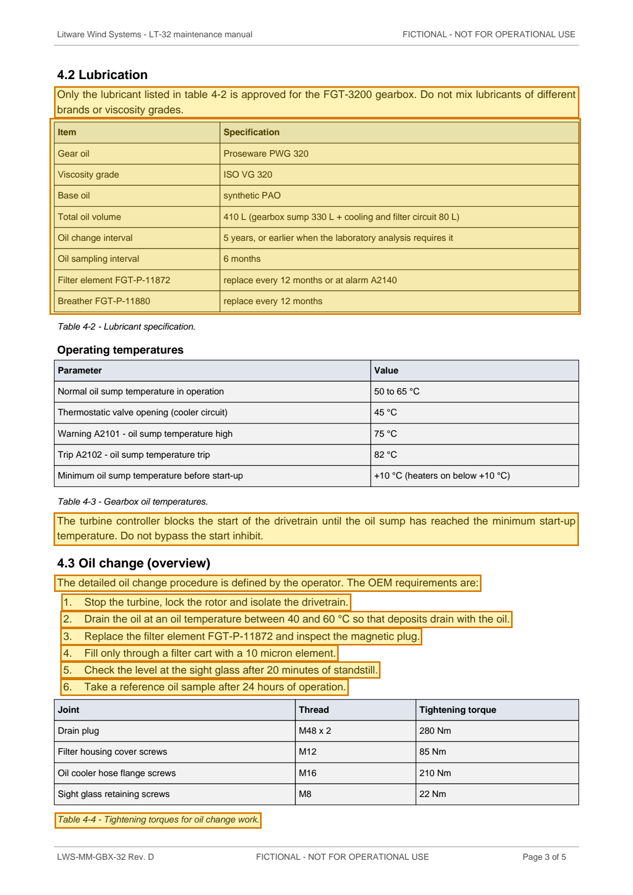

# LWS-MM-GBX-32 Rev. D — LT-32 Maintenance Manual Chapter 4 Gearbox Excerpt — p. 3

Source page: [LWS-MM-GBX-32 Rev. D — LT-32 Maintenance Manual Chapter 4 Gearbox Excerpt](../../sources/lws-mm-gbx-32-revd-gearbox-maintenance-manual-excerpt.md) · Original file: [original.pdf, p. 3](original.pdf#page=3) · Provenance: ✓ quote verified (native text)

## Text

> Only the lubricant listed in table 4-2 is approved for the FGT-3200 gearbox. Do not mix lubricants of different brands or viscosity grades.
>
> The turbine controller blocks the start of the drivetrain until the oil sump has reached the minimum start-up temperature. Do not bypass the start inhibit.
>
> The detailed oil change procedure is defined by the operator. The OEM requirements are:
>
> 1\. Stop the turbine, lock the rotor and isolate the drivetrain.
>
> 2\. Drain the oil at an oil temperature between 40 and 60 °C so that deposits drain with the oil.
>
> 3\. Replace the filter element FGT-P-11872 and inspect the magnetic plug.
>
> 4\. Fill only through a filter cart with a 10 micron element.
>
> 5\. Check the level at the sight glass after 20 minutes of standstill.
>
> 6\. Take a reference oil sample after 24 hours of operation.
>
> Table 4-4 - Tightening torques for oil change work.

## Table t03

| Row | Item | Specification |
| --- | --- | --- |
| 2 | Gear oil | Proseware PWG 320 |
| 3 | Viscosity grade | ISO VG 320 |
| 4 | Base oil | synthetic PAO |
| 5 | Total oil volume | 410 L (gearbox sump 330 L + cooling and filter circuit 80 L) |
| 6 | Oil change interval | 5 years, or earlier when the laboratory analysis requires it |
| 7 | Oil sampling interval | 6 months |
| 8 | Filter element FGT-P-11872 | replace every 12 months or at alarm A2140 |
| 9 | Breather FGT-P-11880 | replace every 12 months |
