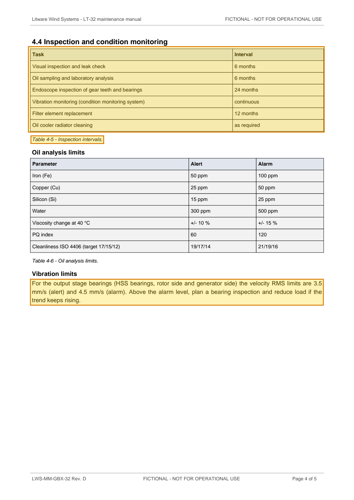

# LWS-MM-GBX-32 Rev. D — LT-32 Maintenance Manual Chapter 4 Gearbox Excerpt — p. 4

Source page: [LWS-MM-GBX-32 Rev. D — LT-32 Maintenance Manual Chapter 4 Gearbox Excerpt](../../sources/lws-mm-gbx-32-revd-gearbox-maintenance-manual-excerpt.md) · Original file: [original.pdf, p. 4](original.pdf#page=4) · Provenance: ✓ quote verified (native text)

## Text

> Table 4-5 - Inspection intervals.
>
> For the output stage bearings (HSS bearings, rotor side and generator side) the velocity RMS limits are 3.5 mm/s (alert) and 4.5 mm/s (alarm). Above the alarm level, plan a bearing inspection and reduce load if the trend keeps rising.

## Table t06

| Row | Task | Interval |
| --- | --- | --- |
| 2 | Visual inspection and leak check | 6 months |
| 3 | Oil sampling and laboratory analysis | 6 months |
| 4 | Endoscope inspection of gear teeth and bearings | 24 months |
| 5 | Vibration monitoring (condition monitoring system) | continuous |
| 6 | Filter element replacement | 12 months |
| 7 | Oil cooler radiator cleaning | as required |
