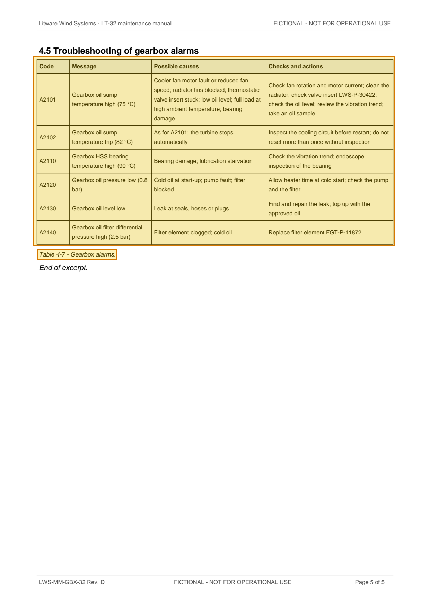

# LWS-MM-GBX-32 Rev. D — LT-32 Maintenance Manual Chapter 4 Gearbox Excerpt — p. 5

Source page: [LWS-MM-GBX-32 Rev. D — LT-32 Maintenance Manual Chapter 4 Gearbox Excerpt](../../sources/lws-mm-gbx-32-revd-gearbox-maintenance-manual-excerpt.md) · Original file: [original.pdf, p. 5](original.pdf#page=5) · Provenance: ✓ quote verified (native text)

## Text

> Table 4-7 - Gearbox alarms.

## Table t08

| Row | Code | Message | Possible causes | Checks and actions |
| --- | --- | --- | --- | --- |
| 2 | A2101 | Gearbox oil sump temperature high (75 °C) | Cooler fan motor fault or reduced fan speed; radiator fins blocked; thermostatic valve insert stuck; low oil level; full load at high ambient temperature; bearing damage | Check fan rotation and motor current; clean the radiator; check valve insert LWS-P-30422; check the oil level; review the vibration trend; take an oil sample |
| 3 | A2102 | Gearbox oil sump temperature trip (82 °C) | As for A2101; the turbine stops automatically | Inspect the cooling circuit before restart; do not reset more than once without inspection |
| 4 | A2110 | Gearbox HSS bearing temperature high (90 °C) | Bearing damage; lubrication starvation | Check the vibration trend; endoscope inspection of the bearing |
| 5 | A2120 | Gearbox oil pressure low (0.8 bar) | Cold oil at start-up; pump fault; filter blocked | Allow heater time at cold start; check the pump and the filter |
| 6 | A2130 | Gearbox oil level low | Leak at seals, hoses or plugs | Find and repair the leak; top up with the approved oil |
| 7 | A2140 | Gearbox oil filter differential pressure high (2.5 bar) | Filter element clogged; cold oil | Replace filter element FGT-P-11872 |
