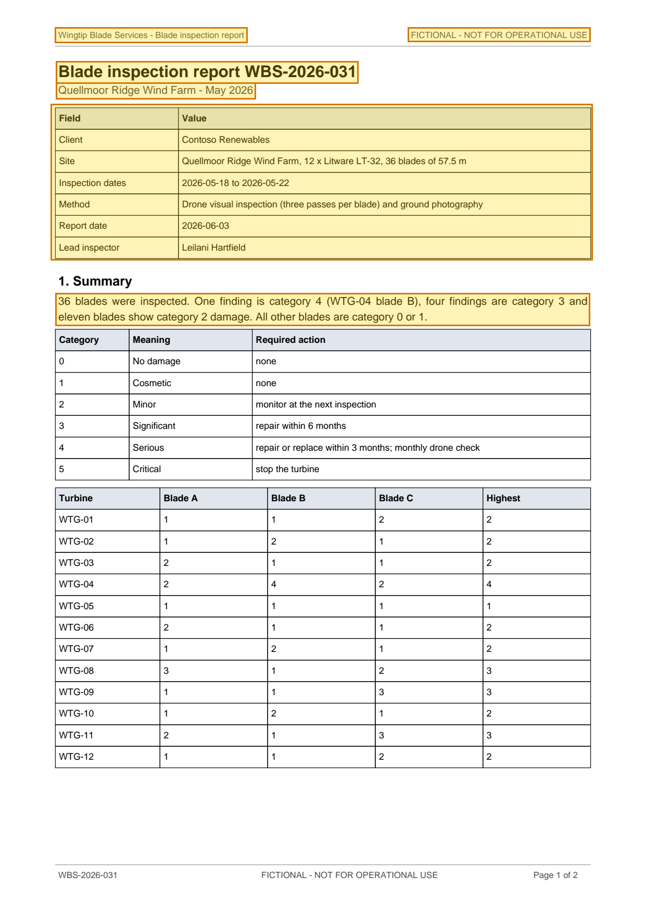

# Blade inspection report WBS-2026-031 - Quellmoor Ridge Wind Farm (May 2026) — p. 1

Source page: [Blade inspection report WBS-2026-031 - Quellmoor Ridge Wind Farm (May 2026)](../../sources/wbs-2026-031-blade-inspection-report.md) · Original file: [original.pdf, p. 1](original.pdf#page=1) · Provenance: ✓ quote verified (native text)

## Text

> Wingtip Blade Services - Blade inspection report
>
> FICTIONAL - NOT FOR OPERATIONAL USE
>
> Blade inspection report WBS-2026-031
>
> Quellmoor Ridge Wind Farm - May 2026
>
> 36 blades were inspected. One finding is category 4 (WTG-04 blade B), four findings are category 3 and eleven blades show category 2 damage. All other blades are category 0 or 1.

## Table t01

| Row | Field | Value |
| --- | --- | --- |
| 2 | Client | Contoso Renewables |
| 3 | Site | Quellmoor Ridge Wind Farm, 12 x Litware LT-32, 36 blades of 57.5 m |
| 4 | Inspection dates | 2026-05-18 to 2026-05-22 |
| 5 | Method | Drone visual inspection (three passes per blade) and ground photography |
| 6 | Report date | 2026-06-03 |
| 7 | Lead inspector | Leilani Hartfield |
