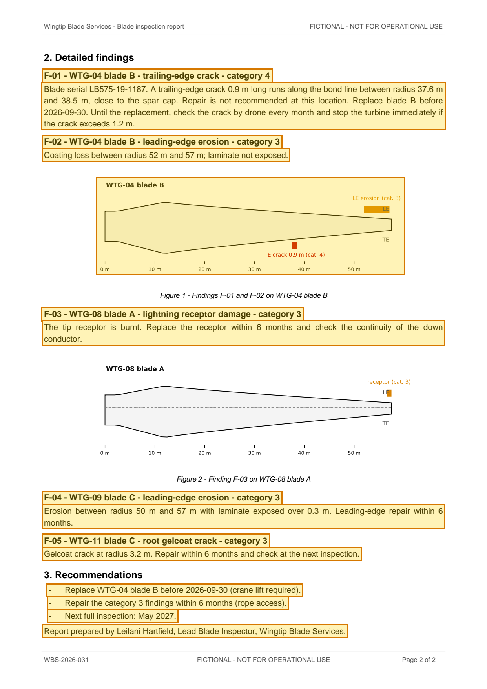
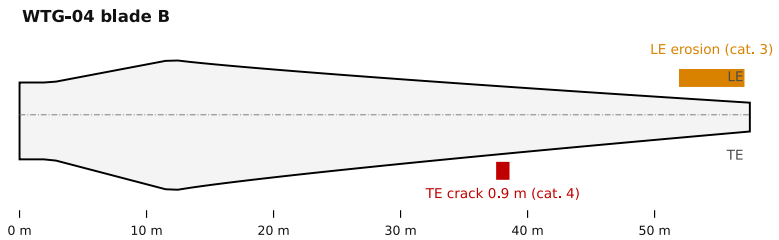

# Blade inspection report WBS-2026-031 - Quellmoor Ridge Wind Farm (May 2026) — p. 2

Source page: [Blade inspection report WBS-2026-031 - Quellmoor Ridge Wind Farm (May 2026)](../../sources/wbs-2026-031-blade-inspection-report.md) · Original file: [original.pdf, p. 2](original.pdf#page=2) · Provenance: ✓ quote verified (native text) · Figures: generated description (model output, not verified)

## Text

> F-01 - WTG-04 blade B - trailing-edge crack - category 4
>
> Blade serial LB575-19-1187. A trailing-edge crack 0.9 m long runs along the bond line between radius 37.6 m and 38.5 m, close to the spar cap. Repair is not recommended at this location. Replace blade B before 2026-09-30. Until the replacement, check the crack by drone every month and stop the turbine immediately if the crack exceeds 1.2 m.
>
> F-02 - WTG-04 blade B - leading-edge erosion - category 3
>
> Coating loss between radius 52 m and 57 m; laminate not exposed.
>
> F-03 - WTG-08 blade A - lightning receptor damage - category 3
>
> The tip receptor is burnt. Replace the receptor within 6 months and check the continuity of the down conductor.
>
> F-04 - WTG-09 blade C - leading-edge erosion - category 3
>
> Erosion between radius 50 m and 57 m with laminate exposed over 0.3 m. Leading-edge repair within 6 months.
>
> F-05 - WTG-11 blade C - root gelcoat crack - category 3
>
> Gelcoat crack at radius 3.2 m. Repair within 6 months and check at the next inspection.
>
> \- Replace WTG-04 blade B before 2026-09-30 (crane lift required).
>
> \- Repair the category 3 findings within 6 months (rope access).
>
> \- Next full inspection: May 2027.
>
> Report prepared by Leilani Hartfield, Lead Blade Inspector, Wingtip Blade Services.

## Figure f01

Caption: Figure 1 - Findings F-01 and F-02 on WTG-04 blade B

> **Generated description** — written by a model from the figure image; not verified against the source.
>
> A schematic outline of a wind turbine blade labeled “WTG-04 blade B,” shown in side view with a dashed centerline and a 0 m to 50 m scale along the bottom. An orange marked area near the blade tip is labeled “LE erosion (cat. 3)” with “LE,” and a red marker below the mid-to-tip section is labeled “TE crack 0.9 m (cat. 4)” with “TE.”
