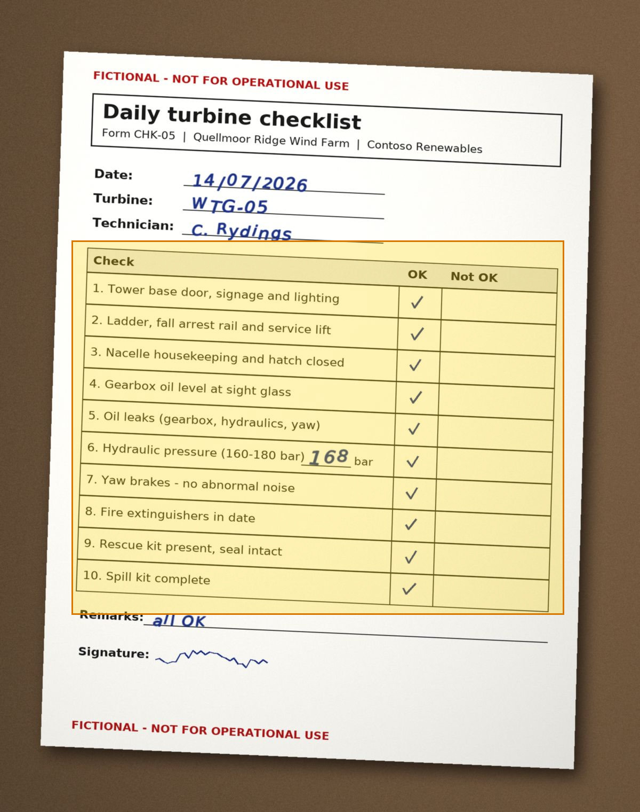

# Daily Turbine Checklist Form CHK-05 for WTG-05, 14/07/2026 — region 8

Source page: [Daily Turbine Checklist Form CHK-05 for WTG-05, 14/07/2026](../../sources/chk-05-daily-checklist-wtg-05-2026-07-14.md) · Original file: [original.jpg](original.jpg) · Provenance: OCR (recognised from pixels, not quote-verified)

## Table t01

| Row | Check | OK | Not OK |
| --- | --- | --- | --- |
| 2 | 1\. Tower base door, signage and lighting | ✓ |  |
| 3 | 2\. Ladder, fall arrest rail and service lift | ✓ |  |
| 4 | 3\. Nacelle housekeeping and hatch closed | ✓ |  |
| 5 | 4\. Gearbox oil level at sight glass | ✓ |  |
| 6 | 5\. Oil leaks (gearbox, hydraulics, yaw) | ✓ |  |
| 7 | 6\. Hydraulic pressure (160-180 bar) 168 bar | ✓ |  |
| 8 | 7\. Yaw brakes - no abnormal noise | ✓ |  |
| 9 | 8\. Fire extinguishers in date | ✓ |  |
| 10 | 9\. Rescue kit present, seal intact | ✓ |  |
| 11 | 10\. Spill kit complete | ✓ |  |
