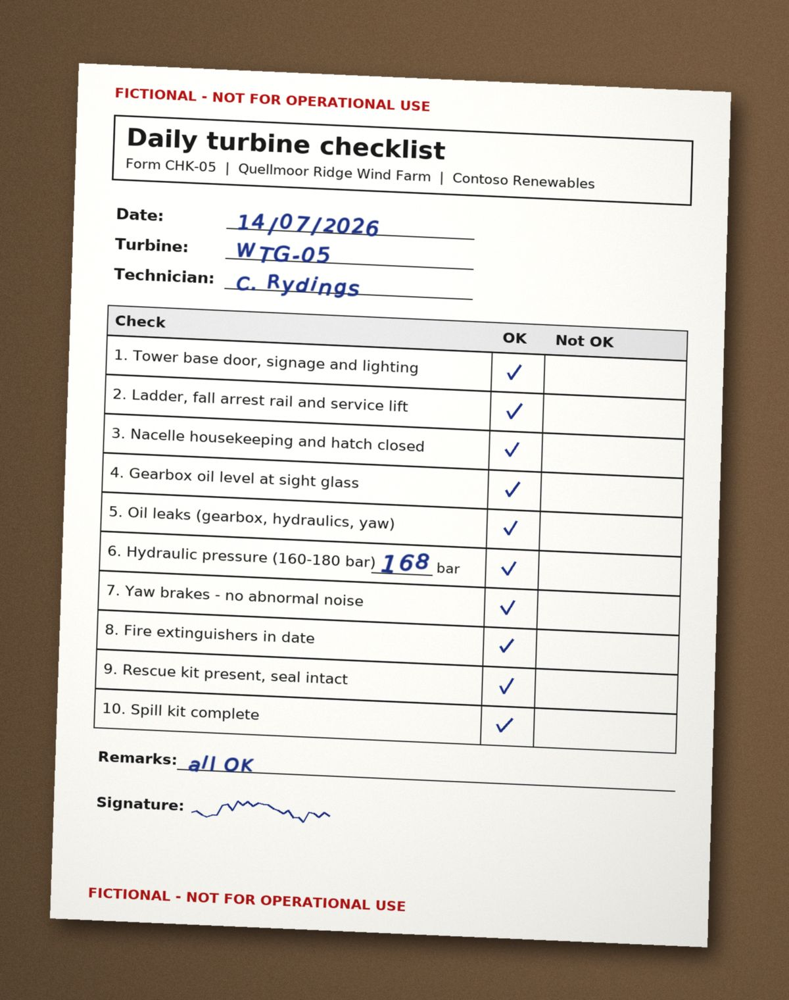

# Daily Turbine Checklist Form CHK-05 for WTG-05, 14/07/2026 — region 12

Source page: [Daily Turbine Checklist Form CHK-05 for WTG-05, 14/07/2026](../../sources/chk-05-daily-checklist-wtg-05-2026-07-14.md) · Original file: [original.jpg](original.jpg) · Provenance: generated description (generated by a model, not verified against the source)

## Figure f01

> **Generated description** — written by a model from the figure image; not verified against the source.
>
> A photographed paper form titled “Daily turbine checklist” for Quellmoor Ridge Wind Farm and Contoso Renewables, marked in red “FICTIONAL - NOT FOR OPERATIONAL USE” at the top and bottom. The form is filled out with date 14/07/2026, turbine WTG-05, technician C. Rydings, and a checklist table with 10 items, each ticked in the OK column; item 6 shows hydraulic pressure 168 bar. At the bottom, the remarks field says “all OK” and there is a handwritten signature line.
