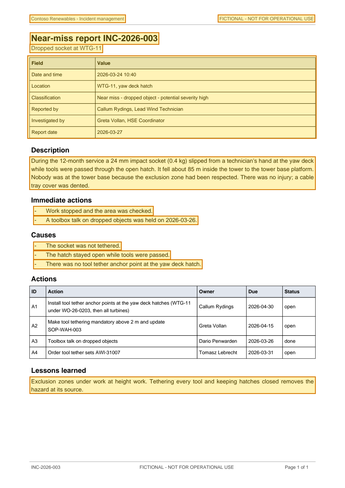

# Near-miss Report INC-2026-003: Dropped Socket at WTG-11 — p. 1

Source page: [Near-miss Report INC-2026-003: Dropped Socket at WTG-11](../../sources/inc-2026-003-near-miss-dropped-socket-wtg-11.md) · Original file: [original.pdf, p. 1](original.pdf#page=1) · Provenance: ✓ quote verified (native text)

## Text

> Contoso Renewables - Incident management
>
> FICTIONAL - NOT FOR OPERATIONAL USE
>
> Near-miss report INC-2026-003
>
> Dropped socket at WTG-11
>
> During the 12-month service a 24 mm impact socket (0.4 kg) slipped from a technician's hand at the yaw deck while tools were passed through the open hatch. It fell about 85 m inside the tower to the tower base platform. Nobody was at the tower base because the exclusion zone had been respected. There was no injury; a cable tray cover was dented.
>
> \- Work stopped and the area was checked.
>
> \- A toolbox talk on dropped objects was held on 2026-03-26.
>
> \- The socket was not tethered.
>
> \- The hatch stayed open while tools were passed.
>
> \- There was no tool tether anchor point at the yaw deck hatch.
>
> Exclusion zones under work at height work. Tethering every tool and keeping hatches closed removes the hazard at its source.

## Table t01

| Row | Field | Value |
| --- | --- | --- |
| 2 | Date and time | 2026-03-24 10:40 |
| 3 | Location | WTG-11, yaw deck hatch |
| 4 | Classification | Near miss - dropped object - potential severity high |
| 5 | Reported by | Callum Rydings, Lead Wind Technician |
| 6 | Investigated by | Greta Vollan, HSE Coordinator |
| 7 | Report date | 2026-03-27 |
