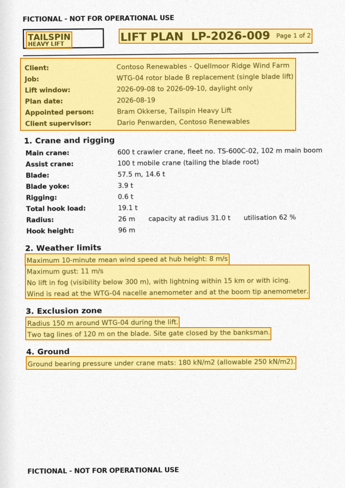
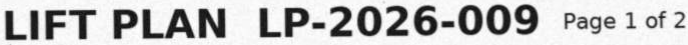
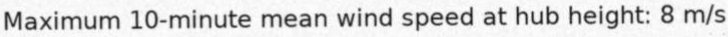
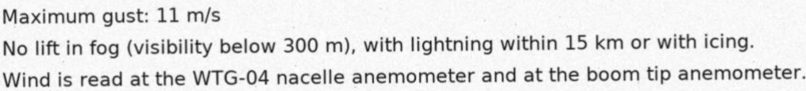
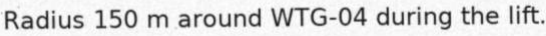
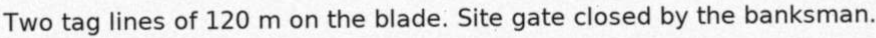
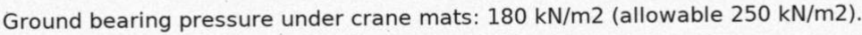

# Lift Plan LP-2026-009 - WTG-04 Blade B Replacement — p. 1

Source page: [Lift Plan LP-2026-009 - WTG-04 Blade B Replacement](../../sources/lp-2026-009-lift-plan-wtg-04-blade-scanned.md) · Original file: [original.pdf, p. 1](original.pdf#page=1) · Provenance: OCR (recognised from pixels, not quote-verified)

## OCR text

> TAILSPIN HEAVY LIFT

OCR confidence: 0.99

> LIFT PLAN LP-2026-009 Page 1 of 2

OCR confidence: 0.97

> Maximum 10-minute mean wind speed at hub height: 8 m/s

OCR confidence: 0.99

> Maximum gust: 11 m/s No lift in fog (visibility below 300 m), with lightning within 15 km or with icing. Wind is read at the WTG-04 nacelle anemometer and at the boom tip anemometer.

OCR confidence: 0.92

> Radius 150 m around WTG-04 during the lift.

OCR confidence: 0.99

> Two tag lines of 120 m on the blade. Site gate closed by the banksman.

OCR confidence: 0.91

> Ground bearing pressure under crane mats: 180 kN/m2 (allowable 250 kN/m2).

OCR confidence: 0.97

## Table t01

| Row | Client: | Contoso Renewables - Quellmoor Ridge Wind Farm |
| --- | --- | --- |
| 2 | Job: | WTG-04 rotor blade B replacement (single blade lift) |
| 3 | Lift window: | 2026-09-08 to 2026-09-10, daylight only |
| 4 | Plan date: | 2026-08-19 |
| 5 | Appointed person: | Bram Okkerse, Tailspin Heavy Lift |
| 6 | Client supervisor: | Dario Penwarden, Contoso Renewables |
