# Lift Plan LP-2026-009 - WTG-04 Blade B Replacement — p. 2

Source page: [Lift Plan LP-2026-009 - WTG-04 Blade B Replacement](../../sources/lp-2026-009-lift-plan-wtg-04-blade-scanned.md) · Original file: [original.pdf, p. 2](original.pdf#page=2) · Provenance: OCR (recognised from pixels, not quote-verified) · Figures: generated description (model output, not verified)

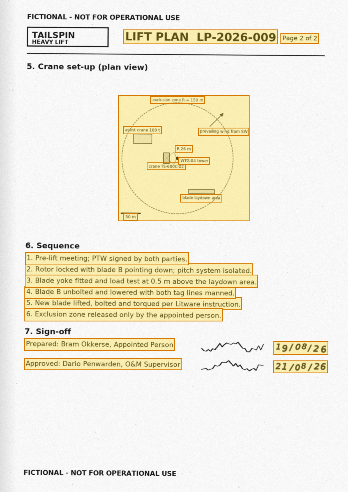

## OCR text

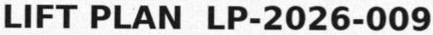

> LIFT PLAN LP-2026-009

OCR confidence: 0.95

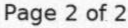

> Page 2 of 2

OCR confidence: 0.99

> exclusion zone R = 150 m

OCR confidence: 0.97

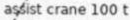

> assist crane 100 t

OCR confidence: 0.74

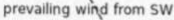

> prevailing wind from SW

OCR confidence: 0.99

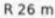

> R 26 m

OCR confidence: 0.99

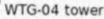

> WTG-04 tower

OCR confidence: 0.98

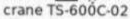

> crane TS-600C-02

OCR confidence: 0.97

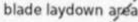

> blade laydown area

OCR confidence: 0.72

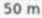

> 50 m

OCR confidence: 0.91

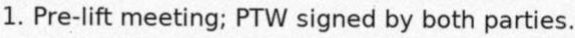

> 1\. Pre-lift meeting; PTW signed by both parties.

OCR confidence: 0.99

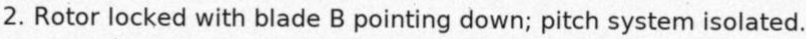

> 2\. Rotor locked with blade B pointing down; pitch system isolated.

OCR confidence: 0.93

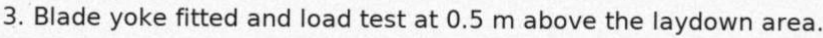

> 3\. Blade yoke fitted and load test at 0.5 m above the laydown area.

OCR confidence: 0.96

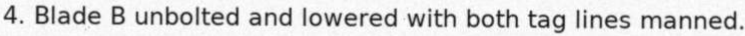

> 4\. Blade B unbolted and lowered with both tag lines manned.

OCR confidence: 0.98

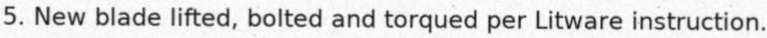

> 5\. New blade lifted, bolted and torqued per Litware instruction.

OCR confidence: 0.98

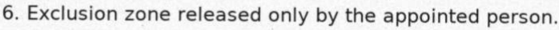

> 6\. Exclusion zone released only by the appointed person.

OCR confidence: 0.98

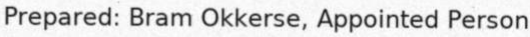

> Prepared: Bram Okkerse, Appointed Person

OCR confidence: 1.00

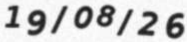

> 19/08/26

OCR confidence: 0.88

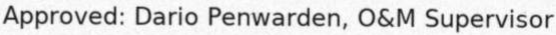

> Approved: Dario Penwarden, O&M Supervisor

OCR confidence: 1.00

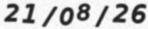

> 21/08/26

OCR confidence: 0.86

## Figure f01

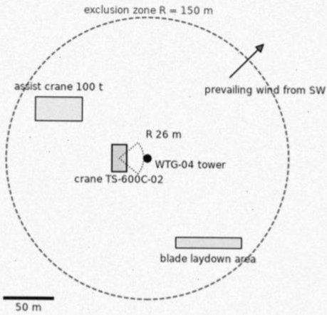

> **Generated description** — written by a model from the figure image; not verified against the source.
>
> A simple site-plan diagram shows a dashed circular exclusion zone labeled “R = 150 m” with an arrow indicating “prevailing wind from SW.” Inside the circle are labeled rectangular areas for an “assist crane 100 t,” a “crane TS-600C-02” near a marked “WTG-04 tower” point with “R 26 m,” and a “blade laydown area” near the bottom. A 50 m scale bar appears at the lower left.
