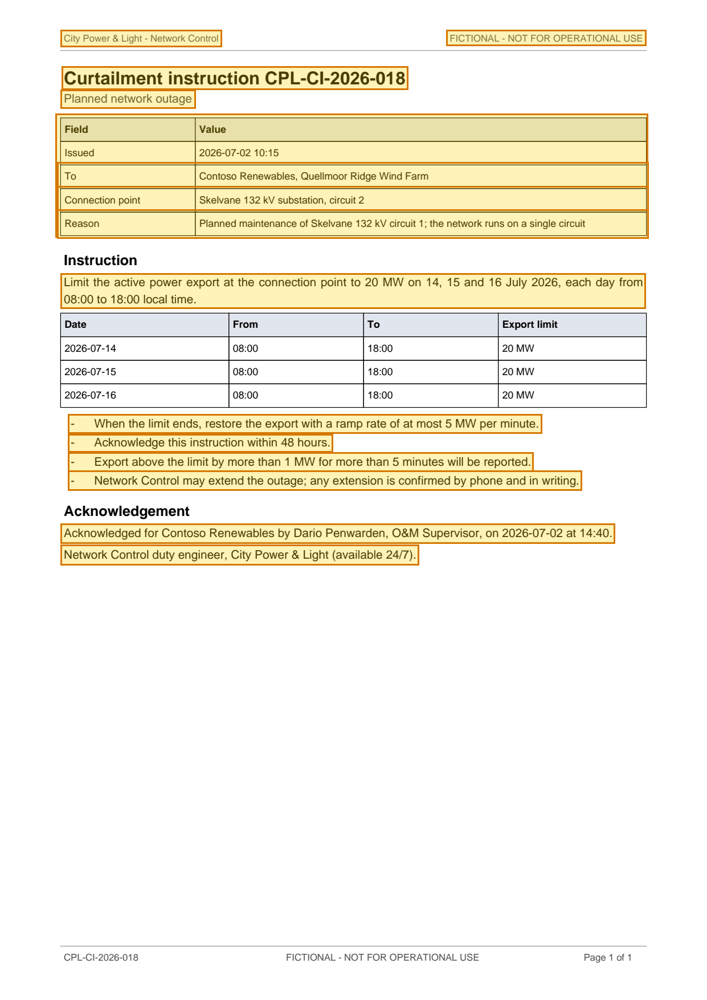

# Curtailment instruction CPL-CI-2026-018 — p. 1

Source page: [Curtailment instruction CPL-CI-2026-018](../../sources/cpl-ci-2026-018-grid-curtailment-instruction.md) · Original file: [original.pdf, p. 1](original.pdf#page=1) · Provenance: ✓ quote verified (native text)

## Text

> City Power & Light - Network Control
>
> FICTIONAL - NOT FOR OPERATIONAL USE
>
> Curtailment instruction CPL-CI-2026-018
>
> Planned network outage
>
> Field: To; Value: Contoso Renewables, Quellmoor Ridge Wind Farm
>
> Field: Connection point; Value: Skelvane 132 kV substation, circuit 2
>
> Field: Reason; Value: Planned maintenance of Skelvane 132 kV circuit 1; the network runs on a single circuit
>
> Limit the active power export at the connection point to 20 MW on 14, 15 and 16 July 2026, each day from 08:00 to 18:00 local time.
>
> \- When the limit ends, restore the export with a ramp rate of at most 5 MW per minute.
>
> \- Acknowledge this instruction within 48 hours.
>
> \- Export above the limit by more than 1 MW for more than 5 minutes will be reported.
>
> \- Network Control may extend the outage; any extension is confirmed by phone and in writing.
>
> Acknowledged for Contoso Renewables by Dario Penwarden, O&M Supervisor, on 2026-07-02 at 14:40.
>
> Network Control duty engineer, City Power & Light (available 24/7).

## Table t01

| Row | Field | Value |
| --- | --- | --- |
| 2 | Issued | 2026-07-02 10:15 |
| 3 | To | Contoso Renewables, Quellmoor Ridge Wind Farm |
| 4 | Connection point | Skelvane 132 kV substation, circuit 2 |
| 5 | Reason | Planned maintenance of Skelvane 132 kV circuit 1; the network runs on a single circuit |
