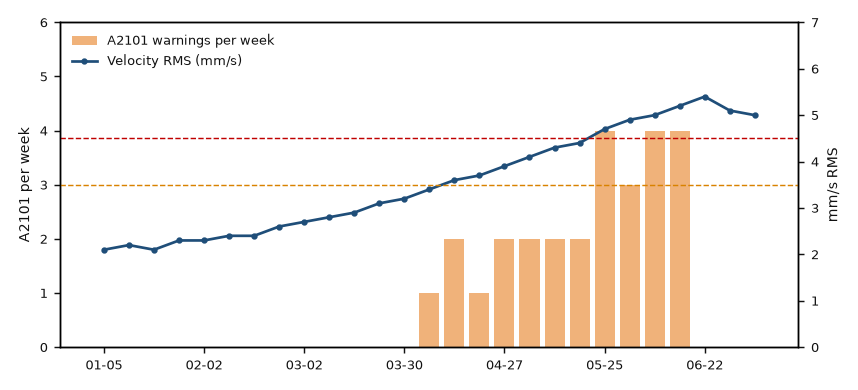

# 8D report INC-2026-006 - Repeated gearbox oil over-temperature on WTG-07 (revision 2026-07-10) — ¶ 8

Source page: [8D report INC-2026-006 - Repeated gearbox oil over-temperature on WTG-07 (revision 2026-07-10)](../../sources/inc-2026-006-8d-report-wtg-07-gearbox-over-temperature.md) · Original file: [original.docx](original.docx) · Provenance: ✓ quote verified (native text) · Figures: generated description (model output, not verified)

## Text

> Figure 1 - WTG-07: weekly A2101 warnings and HSS bearing vibration (2026)

## Figure f01

> **Generated description** — written by a model from the figure image; not verified against the source.
>
> A dual-axis time series chart shows A2101 warnings per week as orange bars and Velocity RMS (mm/s) as a blue line with circular markers. The left y-axis is labeled A2101 per week from 0 to 6, and the right y-axis is labeled mm/s RMS from 0 to 7; two horizontal dashed reference lines appear at about 3 and 3.9. The blue line rises steadily from about 2.1 mm/s in early January to a peak near 5.4 mm/s in late June, while the orange bars begin in late March and increase to around 4 warnings per week by late May and June.
