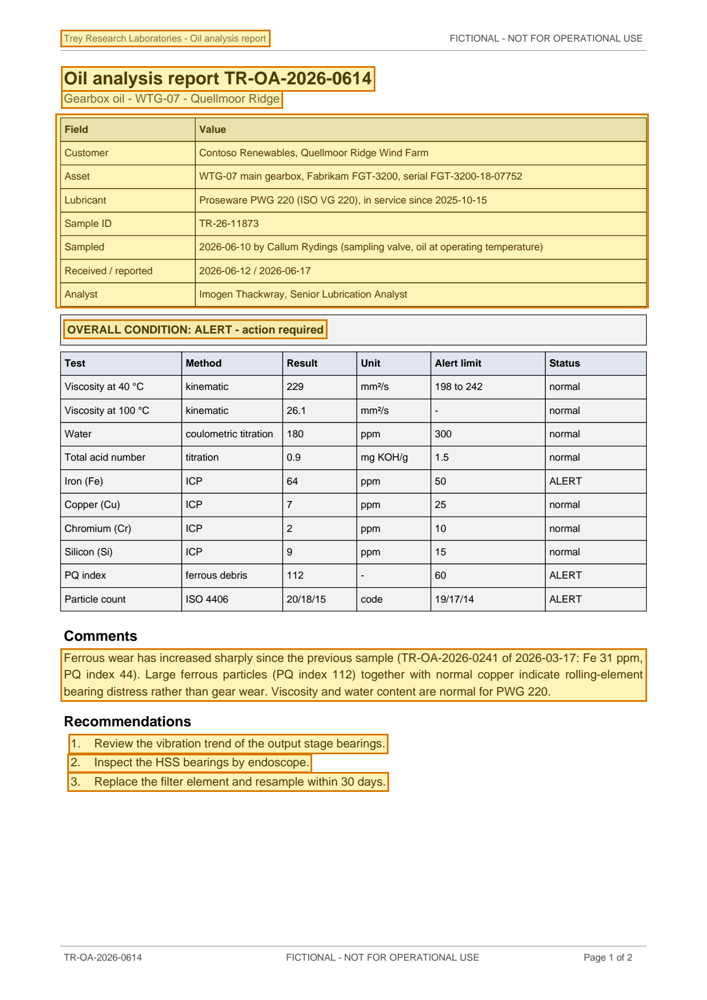

# Oil analysis report TR-OA-2026-0614 - WTG-07 gearbox oil — p. 1

Source page: [Oil analysis report TR-OA-2026-0614 - WTG-07 gearbox oil](../../sources/tr-oa-2026-0614-oil-analysis-wtg-07.md) · Original file: [original.pdf, p. 1](original.pdf#page=1) · Provenance: ✓ quote verified (native text)

## Text

> Trey Research Laboratories - Oil analysis report
>
> Oil analysis report TR-OA-2026-0614
>
> Gearbox oil - WTG-07 - Quellmoor Ridge
>
> OVERALL CONDITION: ALERT - action required
>
> Ferrous wear has increased sharply since the previous sample (TR-OA-2026-0241 of 2026-03-17: Fe 31 ppm, PQ index 44). Large ferrous particles (PQ index 112) together with normal copper indicate rolling-element bearing distress rather than gear wear. Viscosity and water content are normal for PWG 220.
>
> 1\. Review the vibration trend of the output stage bearings.
>
> 2\. Inspect the HSS bearings by endoscope.
>
> 3\. Replace the filter element and resample within 30 days.

## Table t01

| Row | Field | Value |
| --- | --- | --- |
| 2 | Customer | Contoso Renewables, Quellmoor Ridge Wind Farm |
| 3 | Asset | WTG-07 main gearbox, Fabrikam FGT-3200, serial FGT-3200-18-07752 |
| 4 | Lubricant | Proseware PWG 220 (ISO VG 220), in service since 2025-10-15 |
| 5 | Sample ID | TR-26-11873 |
| 6 | Sampled | 2026-06-10 by Callum Rydings (sampling valve, oil at operating temperature) |
| 7 | Received / reported | 2026-06-12 / 2026-06-17 |
| 8 | Analyst | Imogen Thackwray, Senior Lubrication Analyst |
