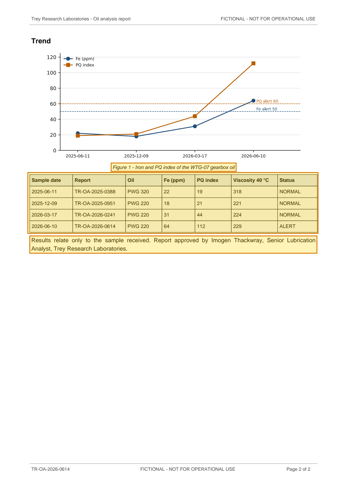

# Oil analysis report TR-OA-2026-0614 - WTG-07 gearbox oil — p. 2

Source page: [Oil analysis report TR-OA-2026-0614 - WTG-07 gearbox oil](../../sources/tr-oa-2026-0614-oil-analysis-wtg-07.md) · Original file: [original.pdf, p. 2](original.pdf#page=2) · Provenance: ✓ quote verified (native text)

## Text

> Figure 1 - Iron and PQ index of the WTG-07 gearbox oil
>
> Results relate only to the sample received. Report approved by Imogen Thackwray, Senior Lubrication Analyst, Trey Research Laboratories.

## Table t03

| Row | Sample date | Report | Oil | Fe (ppm) | PQ index | Viscosity 40 °C | Status |
| --- | --- | --- | --- | --- | --- | --- | --- |
| 2 | 2025-06-11 | TR-OA-2025-0388 | PWG 320 | 22 | 19 | 318 | NORMAL |
| 3 | 2025-12-09 | TR-OA-2025-0951 | PWG 220 | 18 | 21 | 221 | NORMAL |
| 4 | 2026-03-17 | TR-OA-2026-0241 | PWG 220 | 31 | 44 | 224 | NORMAL |
| 5 | 2026-06-10 | TR-OA-2026-0614 | PWG 220 | 64 | 112 | 229 | ALERT |
