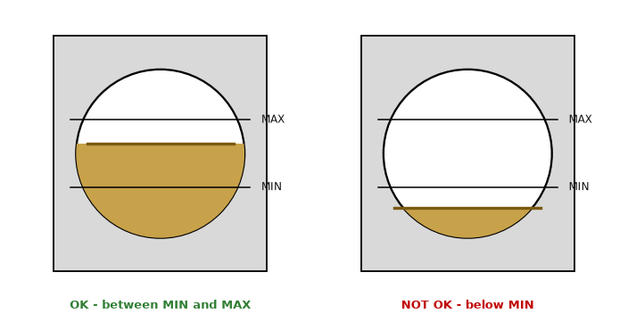

# SPL-012 Gearbox Oil Level Check — slide 2

Source page: [SPL-012 Gearbox Oil Level Check](../../sources/spl-012-gearbox-oil-level-check.md) · Original file: [original.pptx](original.pptx) · Provenance: ✓ quote verified (native text) · Figures: generated description (model output, not verified)

## Text

> Stop the turbine and wait 20 minutes so the oil settles\
> Read the sight glass on the generator side of the gearbox\
> The level must be between MIN and MAX\
> Top up only with PWG 220 through the filter cart (10 micron) - never PWG 320\
> Record the result on the daily checklist (item 4)

## Figure f01

> **Generated description** — written by a model from the figure image; not verified against the source.
>
> The figure shows two side-by-side tank or gauge diagrams with circular containers inside gray panels, each marked with horizontal reference lines labeled MAX and MIN. In the left panel, the yellow liquid level lies between MIN and MAX and is captioned in green “OK - between MIN and MAX,” while in the right panel the yellow liquid is below MIN and is captioned in red “NOT OK - below MIN.”
