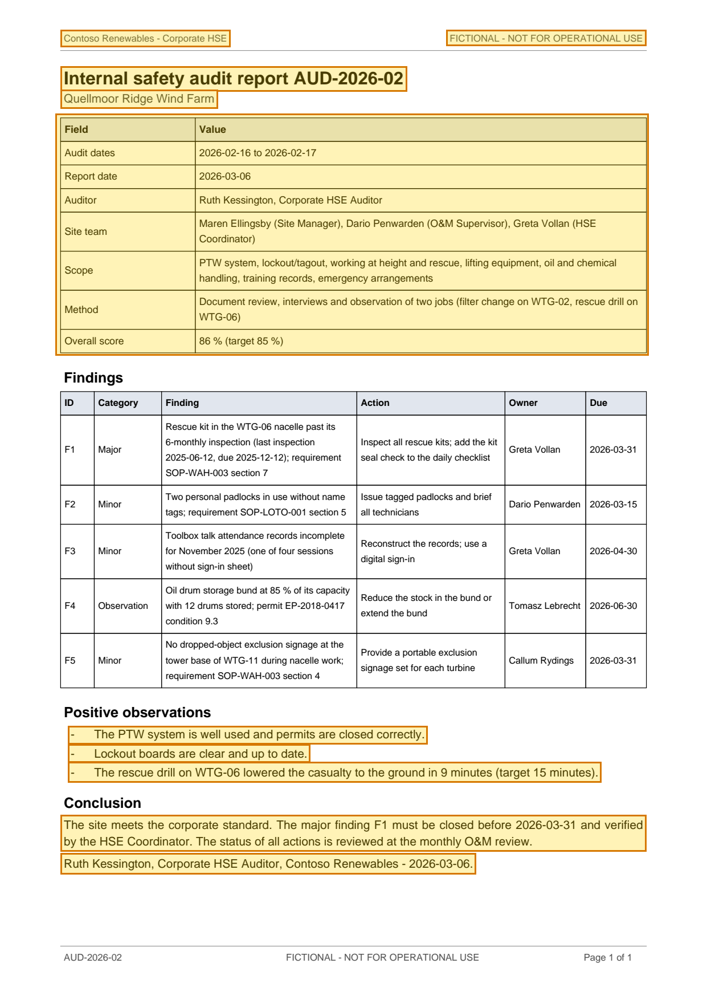

# Internal safety audit report AUD-2026-02 — p. 1

Source page: [Internal safety audit report AUD-2026-02](../../sources/aud-2026-02-internal-safety-audit-report.md) · Original file: [original.pdf, p. 1](original.pdf#page=1) · Provenance: ✓ quote verified (native text)

## Text

> Contoso Renewables - Corporate HSE
>
> FICTIONAL - NOT FOR OPERATIONAL USE
>
> Internal safety audit report AUD-2026-02
>
> Quellmoor Ridge Wind Farm
>
> \- The PTW system is well used and permits are closed correctly.
>
> \- Lockout boards are clear and up to date.
>
> \- The rescue drill on WTG-06 lowered the casualty to the ground in 9 minutes (target 15 minutes).
>
> The site meets the corporate standard. The major finding F1 must be closed before 2026-03-31 and verified by the HSE Coordinator. The status of all actions is reviewed at the monthly O&M review.
>
> Ruth Kessington, Corporate HSE Auditor, Contoso Renewables - 2026-03-06.

## Table t01

| Row | Field | Value |
| --- | --- | --- |
| 2 | Audit dates | 2026-02-16 to 2026-02-17 |
| 3 | Report date | 2026-03-06 |
| 4 | Auditor | Ruth Kessington, Corporate HSE Auditor |
| 5 | Site team | Maren Ellingsby (Site Manager), Dario Penwarden (O&M Supervisor), Greta Vollan (HSE Coordinator) |
| 6 | Scope | PTW system, lockout/tagout, working at height and rescue, lifting equipment, oil and chemical handling, training records, emergency arrangements |
| 7 | Method | Document review, interviews and observation of two jobs (filter change on WTG-02, rescue drill on WTG-06) |
| 8 | Overall score | 86 % (target 85 %) |
