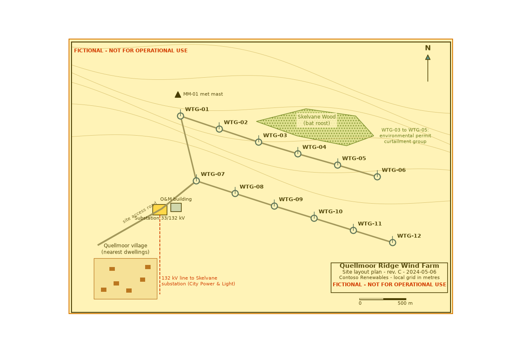
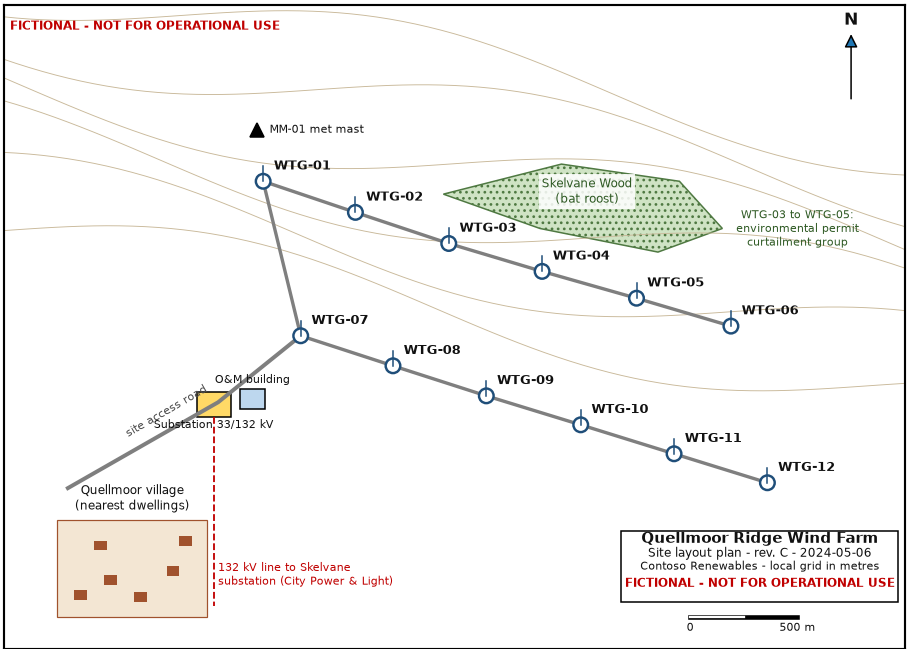

# Quellmoor Ridge Wind Farm Site Layout Plan - Rev. C — region 1

Source page: [Quellmoor Ridge Wind Farm Site Layout Plan - Rev. C](../../sources/site-layout-plan.md) · Original file: [original.png](original.png) · Provenance: generated description (generated by a model, not verified against the source)

## Figure f01

> **Generated description** — written by a model from the figure image; not verified against the source.
>
> A site layout plan for the fictional Quellmoor Ridge Wind Farm, showing twelve labeled wind turbine locations (WTG-01 to WTG-12) connected by gray access-road lines. The map includes a north arrow, a 500 m scale bar, contour lines, a green hatched area labeled “Skelvane Wood (bat roost),” a note for an environmental permit curtailment group covering WTG-03 to WTG-05, a met mast symbol, an O&M building, a substation labeled 33/132 kV, and a nearby Quellmoor village dwellings inset. Red text states “FICTIONAL - NOT FOR OPERATIONAL USE,” and a dashed red 132 kV line runs to the Skelvane substation from the site area.
