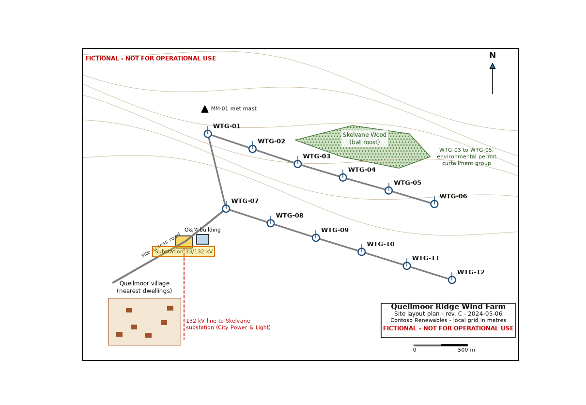

# Quellmoor Ridge Wind Farm Site Layout Plan - Rev. C — region 19

Source page: [Quellmoor Ridge Wind Farm Site Layout Plan - Rev. C](../../sources/site-layout-plan.md) · Original file: [original.png](original.png) · Provenance: OCR (recognised from pixels, not quote-verified)

## OCR text

> Substation 33/132 kV

OCR confidence: 0.89
