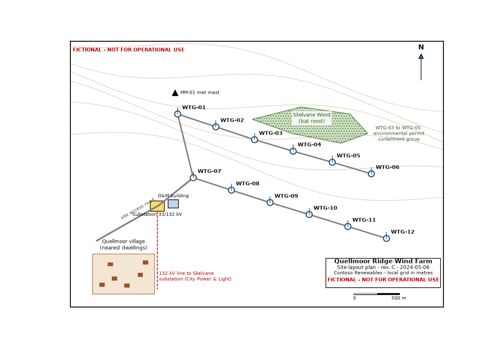

# Quellmoor Ridge Wind Farm Site Layout Plan - Rev. C — region 27

Source page: [Quellmoor Ridge Wind Farm Site Layout Plan - Rev. C](../../sources/site-layout-plan.md) · Original file: [original.png](original.png) · Provenance: generated description (generated by a model, not verified against the source)

## Figure f02

> **Generated description** — written by a model from the figure image; not verified against the source.
>
> A site layout map for the fictional Quellmoor Ridge Wind Farm showing twelve wind turbine locations labeled WTG-01 to WTG-12 connected by gray access tracks. The map includes contour lines, a north arrow, a 500 m scale bar, nearby features such as Skelvane Wood (bat roost), Quellmoor village, a substation, an O&M building, and a 132 kV line, with several red “FICTIONAL - NOT FOR OPERATIONAL USE” notices. An inset at lower left shows the nearest dwellings, and a legend-style title block at lower right identifies the site layout plan and date.
