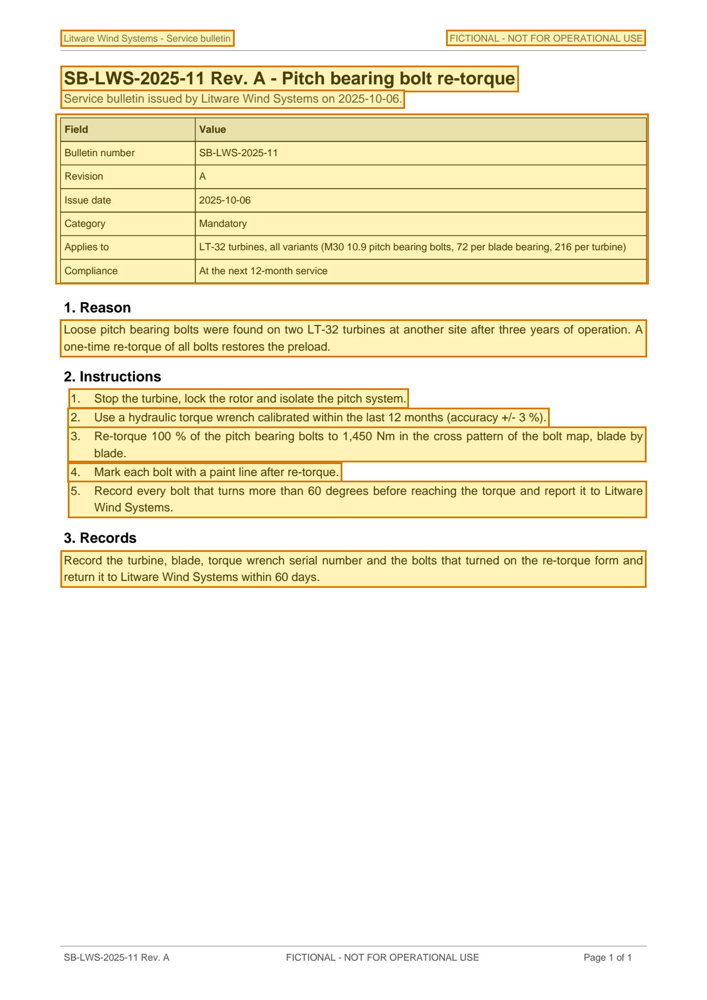

# SB-LWS-2025-11 Rev. A - Pitch Bearing Bolt Re-torque — p. 1

Source page: [SB-LWS-2025-11 Rev. A - Pitch Bearing Bolt Re-torque](../../sources/sb-lws-2025-11-reva-pitch-bearing-bolt-retorque.md) · Original file: [original.pdf, p. 1](original.pdf#page=1) · Provenance: ✓ quote verified (native text)

## Text

> Litware Wind Systems - Service bulletin
>
> FICTIONAL - NOT FOR OPERATIONAL USE
>
> SB-LWS-2025-11 Rev. A - Pitch bearing bolt re-torque
>
> Service bulletin issued by Litware Wind Systems on 2025-10-06.
>
> Loose pitch bearing bolts were found on two LT-32 turbines at another site after three years of operation. A one-time re-torque of all bolts restores the preload.
>
> 1\. Stop the turbine, lock the rotor and isolate the pitch system.
>
> 2\. Use a hydraulic torque wrench calibrated within the last 12 months (accuracy +/- 3 %).
>
> 3\. Re-torque 100 % of the pitch bearing bolts to 1,450 Nm in the cross pattern of the bolt map, blade by blade.
>
> 4\. Mark each bolt with a paint line after re-torque.
>
> 5\. Record every bolt that turns more than 60 degrees before reaching the torque and report it to Litware Wind Systems.
>
> Record the turbine, blade, torque wrench serial number and the bolts that turned on the re-torque form and return it to Litware Wind Systems within 60 days.

## Table t01

| Row | Field | Value |
| --- | --- | --- |
| 2 | Bulletin number | SB-LWS-2025-11 |
| 3 | Revision | A |
| 4 | Issue date | 2025-10-06 |
| 5 | Category | Mandatory |
| 6 | Applies to | LT-32 turbines, all variants (M30 10.9 pitch bearing bolts, 72 per blade bearing, 216 per turbine) |
| 7 | Compliance | At the next 12-month service |
