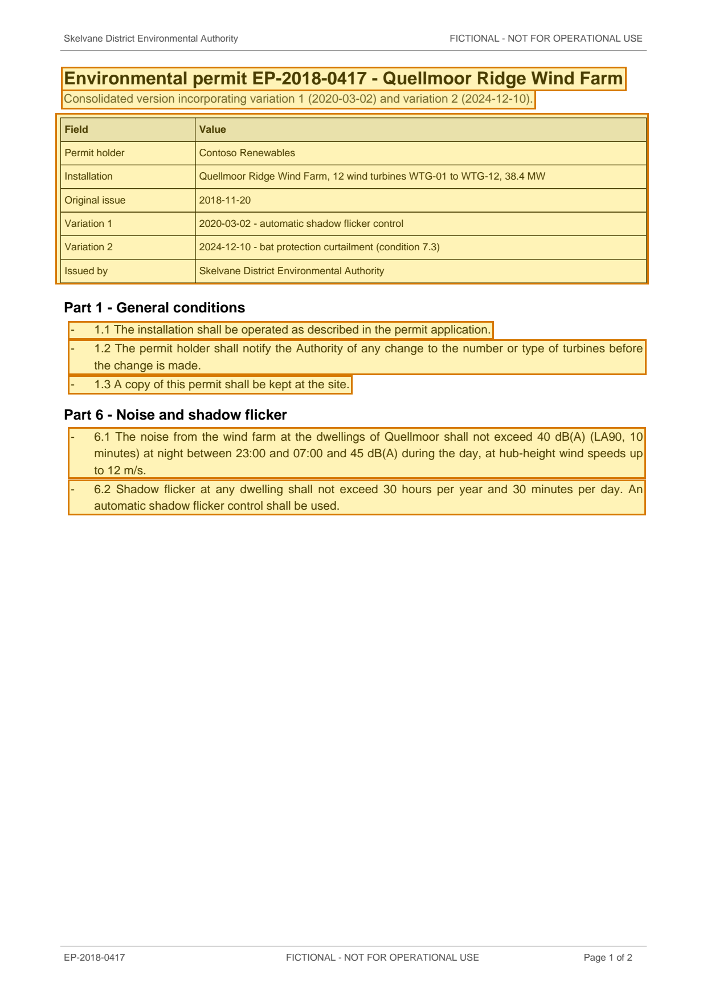

# Environmental Permit EP-2018-0417 - Quellmoor Ridge Wind Farm (consolidated with variation 2) — p. 1

Source page: [Environmental Permit EP-2018-0417 - Quellmoor Ridge Wind Farm (consolidated with variation 2)](../../sources/ep-2018-0417-environmental-permit-consolidated.md) · Original file: [original.pdf, p. 1](original.pdf#page=1) · Provenance: ✓ quote verified (native text)

## Text

> Environmental permit EP-2018-0417 - Quellmoor Ridge Wind Farm
>
> Consolidated version incorporating variation 1 (2020-03-02) and variation 2 (2024-12-10).
>
> \- 1.1 The installation shall be operated as described in the permit application.
>
> \- 1.2 The permit holder shall notify the Authority of any change to the number or type of turbines before the change is made.
>
> \- 1.3 A copy of this permit shall be kept at the site.
>
> \- 6.1 The noise from the wind farm at the dwellings of Quellmoor shall not exceed 40 dB(A) (LA90, 10 minutes) at night between 23:00 and 07:00 and 45 dB(A) during the day, at hub-height wind speeds up to 12 m/s.
>
> \- 6.2 Shadow flicker at any dwelling shall not exceed 30 hours per year and 30 minutes per day. An automatic shadow flicker control shall be used.

## Table t01

| Row | Field | Value |
| --- | --- | --- |
| 2 | Permit holder | Contoso Renewables |
| 3 | Installation | Quellmoor Ridge Wind Farm, 12 wind turbines WTG-01 to WTG-12, 38.4 MW |
| 4 | Original issue | 2018-11-20 |
| 5 | Variation 1 | 2020-03-02 - automatic shadow flicker control |
| 6 | Variation 2 | 2024-12-10 - bat protection curtailment (condition 7.3) |
| 7 | Issued by | Skelvane District Environmental Authority |
