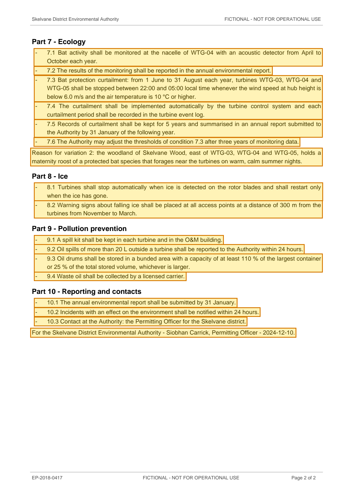

# Environmental Permit EP-2018-0417 - Quellmoor Ridge Wind Farm (consolidated with variation 2) — p. 2

Source page: [Environmental Permit EP-2018-0417 - Quellmoor Ridge Wind Farm (consolidated with variation 2)](../../sources/ep-2018-0417-environmental-permit-consolidated.md) · Original file: [original.pdf, p. 2](original.pdf#page=2) · Provenance: ✓ quote verified (native text)

## Text

> \- 7.1 Bat activity shall be monitored at the nacelle of WTG-04 with an acoustic detector from April to October each year.
>
> \- 7.2 The results of the monitoring shall be reported in the annual environmental report.
>
> \- 7.3 Bat protection curtailment: from 1 June to 31 August each year, turbines WTG-03, WTG-04 and WTG-05 shall be stopped between 22:00 and 05:00 local time whenever the wind speed at hub height is below 6.0 m/s and the air temperature is 10 °C or higher.
>
> \- 7.4 The curtailment shall be implemented automatically by the turbine control system and each curtailment period shall be recorded in the turbine event log.
>
> \- 7.5 Records of curtailment shall be kept for 5 years and summarised in an annual report submitted to the Authority by 31 January of the following year.
>
> \- 7.6 The Authority may adjust the thresholds of condition 7.3 after three years of monitoring data.
>
> Reason for variation 2: the woodland of Skelvane Wood, east of WTG-03, WTG-04 and WTG-05, holds a maternity roost of a protected bat species that forages near the turbines on warm, calm summer nights.
>
> \- 8.1 Turbines shall stop automatically when ice is detected on the rotor blades and shall restart only when the ice has gone.
>
> \- 8.2 Warning signs about falling ice shall be placed at all access points at a distance of 300 m from the turbines from November to March.
>
> \- 9.1 A spill kit shall be kept in each turbine and in the O&M building.
>
> \- 9.2 Oil spills of more than 20 L outside a turbine shall be reported to the Authority within 24 hours.
>
> \- 9.3 Oil drums shall be stored in a bunded area with a capacity of at least 110 % of the largest container or 25 % of the total stored volume, whichever is larger.
>
> \- 9.4 Waste oil shall be collected by a licensed carrier.
>
> \- 10.1 The annual environmental report shall be submitted by 31 January.
>
> \- 10.2 Incidents with an effect on the environment shall be notified within 24 hours.
>
> \- 10.3 Contact at the Authority: the Permitting Officer for the Skelvane district.
>
> For the Skelvane District Environmental Authority - Siobhan Carrick, Permitting Officer - 2024-12-10.
