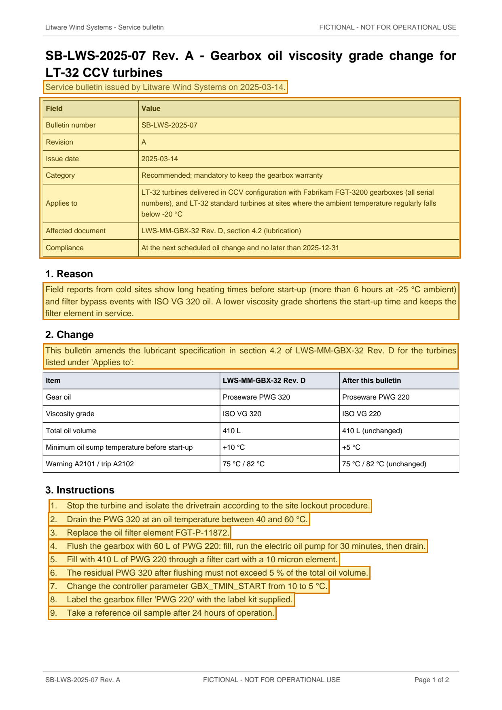

# SB-LWS-2025-07 Rev. A - Gearbox oil viscosity grade change for LT-32 CCV turbines — p. 1

Source page: [SB-LWS-2025-07 Rev. A - Gearbox oil viscosity grade change for LT-32 CCV turbines](../../sources/sb-lws-2025-07-reva-gearbox-oil-cold-climate.md) · Original file: [original.pdf, p. 1](original.pdf#page=1) · Provenance: ✓ quote verified (native text)

## Text

> Service bulletin issued by Litware Wind Systems on 2025-03-14.
>
> Field reports from cold sites show long heating times before start-up (more than 6 hours at -25 °C ambient) and filter bypass events with ISO VG 320 oil. A lower viscosity grade shortens the start-up time and keeps the filter element in service.
>
> This bulletin amends the lubricant specification in section 4.2 of LWS-MM-GBX-32 Rev. D for the turbines listed under 'Applies to':
>
> 1\. Stop the turbine and isolate the drivetrain according to the site lockout procedure.
>
> 2\. Drain the PWG 320 at an oil temperature between 40 and 60 °C.
>
> 3\. Replace the oil filter element FGT-P-11872.
>
> 4\. Flush the gearbox with 60 L of PWG 220: fill, run the electric oil pump for 30 minutes, then drain.
>
> 5\. Fill with 410 L of PWG 220 through a filter cart with a 10 micron element.
>
> 6\. The residual PWG 320 after flushing must not exceed 5 % of the total oil volume.
>
> 7\. Change the controller parameter GBX\_TMIN\_START from 10 to 5 °C.
>
> 8\. Label the gearbox filler 'PWG 220' with the label kit supplied.
>
> 9\. Take a reference oil sample after 24 hours of operation.

## Table t01

| Row | Field | Value |
| --- | --- | --- |
| 2 | Bulletin number | SB-LWS-2025-07 |
| 3 | Revision | A |
| 4 | Issue date | 2025-03-14 |
| 5 | Category | Recommended; mandatory to keep the gearbox warranty |
| 6 | Applies to | LT-32 turbines delivered in CCV configuration with Fabrikam FGT-3200 gearboxes (all serial numbers), and LT-32 standard turbines at sites where the ambient temperature regularly falls below -20 °C |
| 7 | Affected document | LWS-MM-GBX-32 Rev. D, section 4.2 (lubrication) |
| 8 | Compliance | At the next scheduled oil change and no later than 2025-12-31 |
