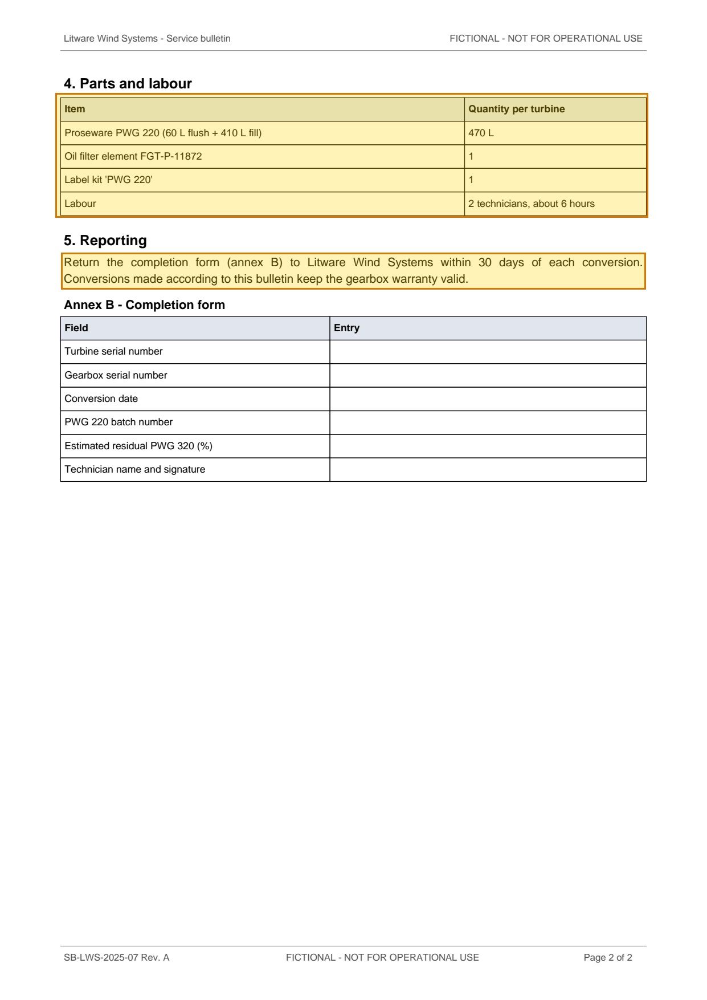

# SB-LWS-2025-07 Rev. A - Gearbox oil viscosity grade change for LT-32 CCV turbines — p. 2

Source page: [SB-LWS-2025-07 Rev. A - Gearbox oil viscosity grade change for LT-32 CCV turbines](../../sources/sb-lws-2025-07-reva-gearbox-oil-cold-climate.md) · Original file: [original.pdf, p. 2](original.pdf#page=2) · Provenance: ✓ quote verified (native text)

## Text

> Return the completion form (annex B) to Litware Wind Systems within 30 days of each conversion. Conversions made according to this bulletin keep the gearbox warranty valid.

## Table t03

| Row | Item | Quantity per turbine |
| --- | --- | --- |
| 2 | Proseware PWG 220 (60 L flush + 410 L fill) | 470 L |
| 3 | Oil filter element FGT-P-11872 | 1 |
| 4 | Label kit 'PWG 220' | 1 |
| 5 | Labour | 2 technicians, about 6 hours |
